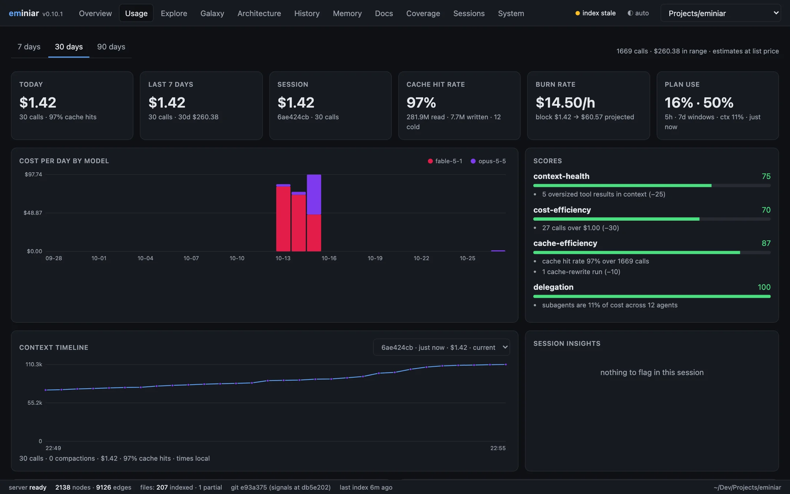
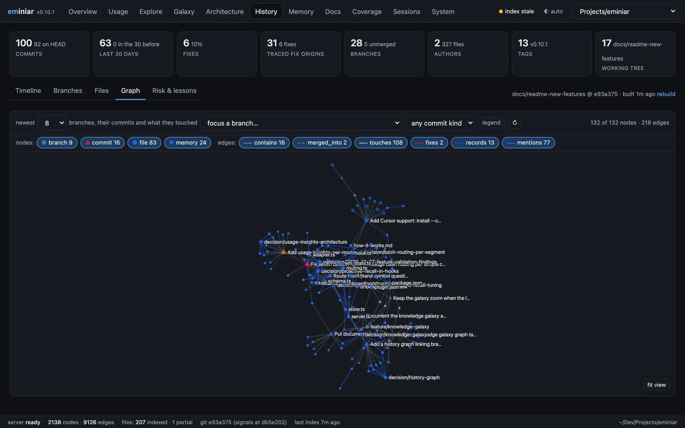
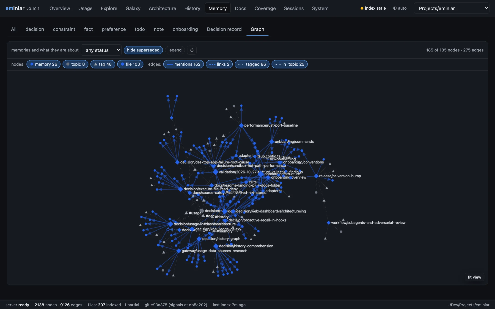
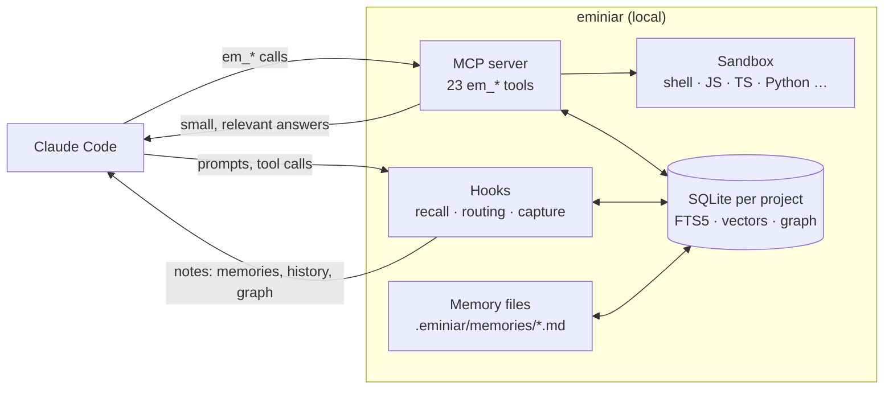

<div align="center">

# eminiar

**A memory, a code map and a clean context window for Claude Code and Cursor — all on your machine.**

*Pronounced ee-MIN-ee-ar*

[](#license)
[](https://nodejs.org)
[](https://docs.claude.com/en/docs/claude-code)
[](docs/getting-started.md#cursor)
[](docs/how-it-works.md#privacy-and-data)

[Quick start](#quick-start) · [Features](#what-you-get) · [How it works](docs/how-it-works.md) · [Tools](docs/tools.md) · [Docs](docs/README.md)

<br/>

<picture>
  <source media="(prefers-color-scheme: dark)" srcset="docs/images/dashboard-explore-dark.webp">
  
</picture>

<sub>The local dashboard: source, file impact and the memories linked to the file.</sub>

</div>

---

## The problem

Claude Code is very capable, but three things slow it down on a real project:

1. **The context window fills with noise.** One `git log`, test run or API response can use
   thousands of tokens. Claude needs only a few lines of it.
2. **Every session starts from zero.** Decisions, constraints and fixed bugs are lost after a
   `/compact` or a new session. Claude asks again, or repeats a mistake.
3. **Claude reads code without a map.** It does not know which files are fragile, which files
   import a function, or why a line changed.

## The solution

eminiar is a Claude Code plugin that also installs into Cursor. It adds an MCP server with 23
`em_*` tools and a set of hooks.
Everything runs locally in one SQLite database per project.

| | Without eminiar | With eminiar |
|---|---|---|
| **Large output** | The full output goes into context | Output is indexed. Only the sections that match your `intent` come back |
| **Memory** | Lost at `/compact` or a new session | Markdown memories in your repo, given back to Claude when they are relevant |
| **Code structure** | `grep` and full-file reads | A knowledge graph of files, symbols, calls, routes and hotspots |
| **Git history** | Raw `git log` / `git blame` | Classified commits, fix tracing, and a graph from branches to the files, memories and docs they touched |
| **Library docs** | Web search on each question | A local, searchable index of the docs your project uses |
| **Getting knowledge** | Claude must remember to ask | Hooks push the relevant knowledge to Claude **automatically** |
| **Cost** | A guess, one session at a time | Tokens, cache hits and estimated cost for every model call, with insights |

## What you get

### 🧪 Sandboxed execution — keep raw output out of context

`em_execute`, `em_batch_execute` and `em_execute_file` run shell, JavaScript and TypeScript, plus
Python, Ruby, Go, PHP, Perl, R, Elixir, Rust and C# when they are installed. Output over 5 KB is
indexed. Claude gets back only the sections that match its `intent`. Snippets obey your Claude
Code `Bash` deny rules, and `em_execute_file` refuses a `path` that one of your `Read` deny rules
matches ([which rule forms](docs/how-it-works.md#sandbox)).

Hooks route noisy commands for Claude. A Bash line is judged one command at a time: output that
is already bounded (`| head`, `| wc`, `grep -l`, `cat` of a small file) and commands that change
files stay native. `git log`, `git blame` and `git show` go to `em_history`, and a `Grep` for a
symbol the graph knows goes to `em_symbols`. `em_stats` shows each routing decision and the rule
behind it, so you can see what was sent where.

### 🔎 Hybrid search — keyword and meaning together

SQLite FTS5 (porter + trigram, BM25, typo correction) is fused with local ONNX embeddings
(`bge-small` through `sqlite-vec`). Search covers command output, files, fetched pages,
documentation, memories, git messages and session history. It never waits for the model to
download.

### 🧠 Memory that comes back by itself

`em_remember` writes plain markdown files to `.eminiar/memories/`. You can read them, edit them
and commit them. Decisions have an ADR-style status (`proposed`, `accepted`, `superseded`). Hooks
attach matching memories to your prompts, to file reads and edits, to failed commands and to
subagent briefs. **Claude does not have to remember to look.**

Recall matches a memory when the prompt names it, one of its tags, a file it mentions or a
symbol from that file. A memory can come back later in a long session. To see why a memory did
or did not appear, run `eminiar recall --explain "<prompt>"`.

### 🕸️ Code knowledge graph — a map before an edit

tree-sitter parses TypeScript, JavaScript, Python, Go and PHP into files, symbols, imports, calls,
references, inheritance and HTTP routes (Express, Fastify, Koa, hapi, Hono, Moleculer, Next.js,
Python decorator routes, Go routers, Laravel, Symfony and Slim). eminiar
adds fan-in, complexity, churn, a hotspot score, module clusters, import cycles and git co-change
coupling. Ask *"what breaks if I change this?"* with `em_graph_impact`.

Memories and documentation share the same graph. Each memory links to the files and symbols it
mentions, and each doc source links to the code that uses it. One graph answers *"what do we
know about this file?"*

### 📜 Git history, read for Claude

`em_history` classifies every commit (feat, fix, refactor, perf …). It traces each fix back to
the commit that wrote the broken lines. Files get a risk score with reasons. Before Claude edits
a bug-prone file, it sees the record.

The history graph connects branches to their commits, commits to the files they changed, and
those files to the memories and docs about them. Merged and deleted branches keep their commits.
A fix points at the commit it repairs.

### 📚 Documentation knowledge base

`em_docs` finds your local docs (READMEs, ADRs, OpenAPI, Postman) and the libraries, services
and third-party APIs your code calls. It indexes their documentation locally. OpenAPI specs are
split into one section per endpoint, so a lookup returns the exact operation.

### 💸 Usage insights — what each session really costs

`em_usage` reads the transcripts Claude Code keeps on your machine and records tokens, cache
traffic and estimated cost per model call: cost today and this week, cache hit rate, per-model
and per-session breakdowns, 5-hour billing blocks with burn rate, the context timeline of a
session with its compactions, which tools fill the context, insights with recommendations, and
what eminiar's own tools saved in dollars. Everything stays local; cost is an estimate at list
price ([details](docs/usage.md)).

### 📊 Local dashboard

`eminiar ui` opens a local web app with token savings, usage and cost, a source explorer with
impact analysis, a graph "galaxy", an architecture map, a history explorer with a history
graph, a memory editor with a memory graph, and a docs manager.

| | |
|:---:|:---:|
| [](docs/dashboard.md#galaxy) | [](docs/dashboard.md#usage) |
| **Galaxy:** the knowledge graph | **Usage:** cost, cache and burn rate |
| [](docs/dashboard.md#history) | [](docs/dashboard.md#memory) |
| **History graph:** branches to files and memories | **Memory graph:** what each memory is about |
| [](docs/dashboard.md#history) | [](docs/dashboard.md#architecture) |
| **History:** classified commits and fix tracing | **Hotspots:** where change is risky |

## What Claude sees

Hooks add short notes to the conversation at the right moment. These examples are real output:

```text
eminiar recall — project memories and indexed docs that match this request:
- memory decision/proactive-recall-in-hooks [decision]: Project knowledge is pushed to Claude by hooks …

eminiar history: src/cli.ts is bug-prone (1/6 commits were fixes; 1 earlier change later needed
fixing; last fix 3f8c697 Fix MCP registration, make enforce routing and dev upgrades safe).

eminiar graph: src/cli.ts is imported by 6 files; em_graph_impact {node:"file:src/cli.ts"} lists
them before you change an exported signature.
```

When a command would flood the context, routing names the tool to use instead:

```text
eminiar: `git diff .claude-plugin/plugin.json package.json README.md` usually prints a lot;
em_execute {language:"shell", code, intent} keeps the output out of context and returns only
matching sections. Retry with em_execute.

eminiar history: this commit includes files that deserve a second look:
- package.json is bug-prone (3/25 commits were fixes; 2 earlier changes later needed fixing)
```

Each note appears once per context window. After a `/compact`, notes come back when they are
relevant again.

## Quick start

**Requirements:** Node.js 22.12 or later, and Claude Code or Cursor.

```sh
npx eminiar install           # registers the plugin, installs a stable copy, downloads the model
npx eminiar install --cursor  # the same, plus hooks, MCP server and skills for Cursor
npx eminiar doctor            # checks every part
```

Restart Claude Code (or Cursor). Then, in your project:

```text
/em-onboard             # writes onboarding memories and builds the docs knowledge base
```

That is all. Use Claude Code or Cursor as usual. To see how much context eminiar saves, run
`/em-stats` or open the dashboard with `eminiar ui`. One flag covers Cursor because the hook
runner speaks both dialects; see [Cursor](docs/getting-started.md#cursor) for what differs.

**For a team:** run `npx eminiar install --team` once and commit `eminiar.config.json` and
`.eminiar/`. Teammates then run `npx eminiar install`. See
[Getting started](docs/getting-started.md#team-setup).

## How it works



- **Hooks** run on session start, prompts, tool calls and failures. They capture session events,
  route noisy commands to the sandbox, and attach relevant knowledge.
- **The MCP server** provides the `em_*` tools and keeps the index and graph up to date.
- **Storage** is one SQLite file per project under `~/.eminiar/`. Memories also live as markdown
  in your repo.

Read more in [How it works](docs/how-it-works.md).

## Documentation

| Guide | Contents |
|---|---|
| [Getting started](docs/getting-started.md) | Install, team setup, first steps, upgrade and uninstall |
| [How it works](docs/how-it-works.md) | Architecture, routing modes, session continuity, privacy |
| [Tools reference](docs/tools.md) | Every `em_*` tool and slash command |
| [Memory and recall](docs/memory-and-recall.md) | Memory files, decisions, automatic recall |
| [Knowledge graph and history](docs/knowledge-graph.md) | Graph, symbols, impact analysis, git history |
| [Documentation knowledge base](docs/documentation-kb.md) | Discover, index and look up docs |
| [Usage insights](docs/usage.md) | Tokens, cache, cost, billing blocks, insights and savings per session |
| [Dashboard](docs/dashboard.md) | The `eminiar ui` web app |
| [Configuration](docs/configuration.md) | Every config key with its default |
| [CLI](docs/cli.md) | The `eminiar` command |
| [Troubleshooting](docs/troubleshooting.md) | Common problems and fixes |
| [Development](docs/development.md) | Build, test, benchmark and project layout |

## Privacy

Your code, tool output and memories stay on your machine. eminiar uses the network only to:

- download the embedding model once (you can skip this with `install --no-model`);
- fetch web pages and documentation that you or Claude ask it to index;
- look up package metadata in the npm, PyPI and Go registries when it adds documentation.

The dashboard listens on `127.0.0.1` only.

## License

MIT © Ryan Dick
