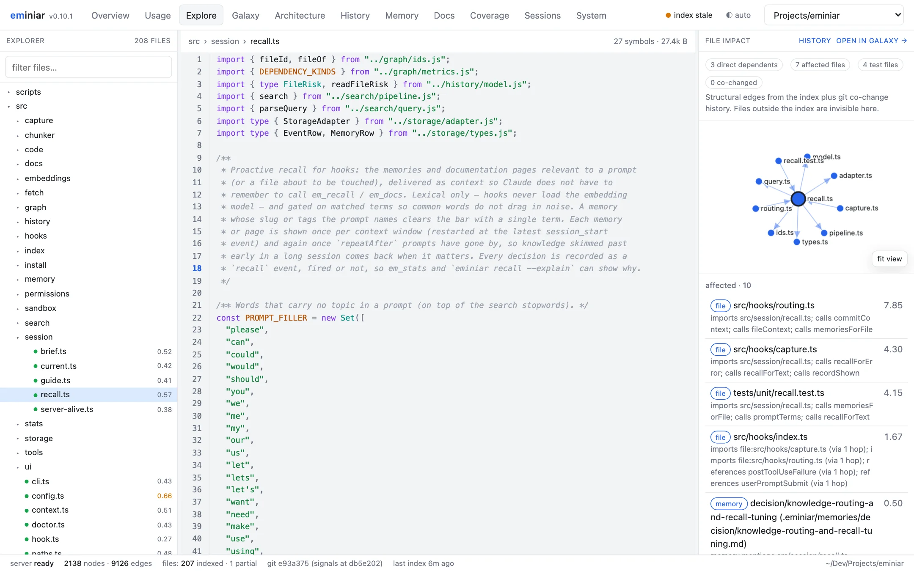
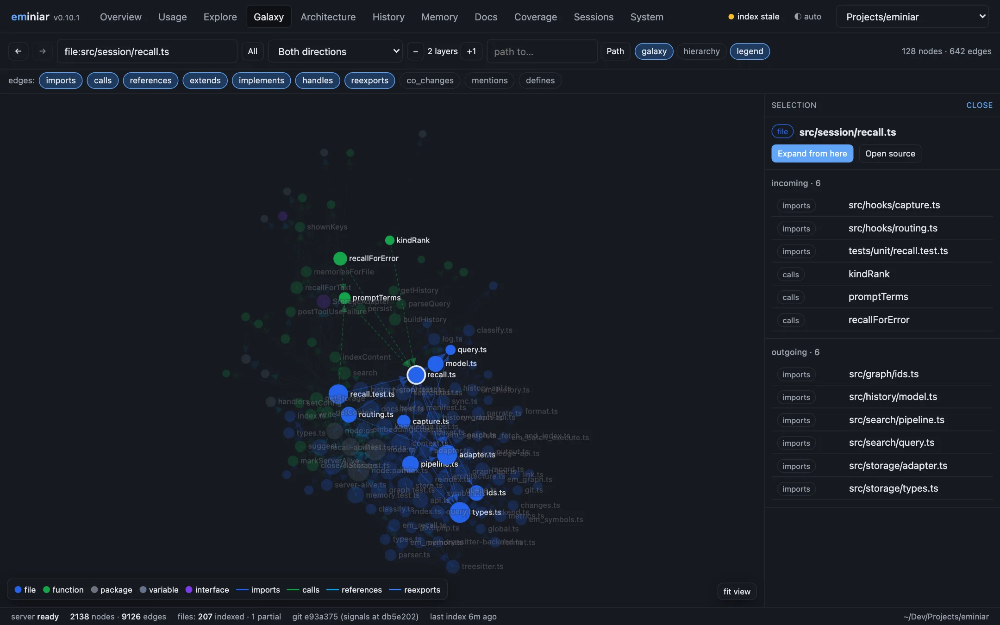
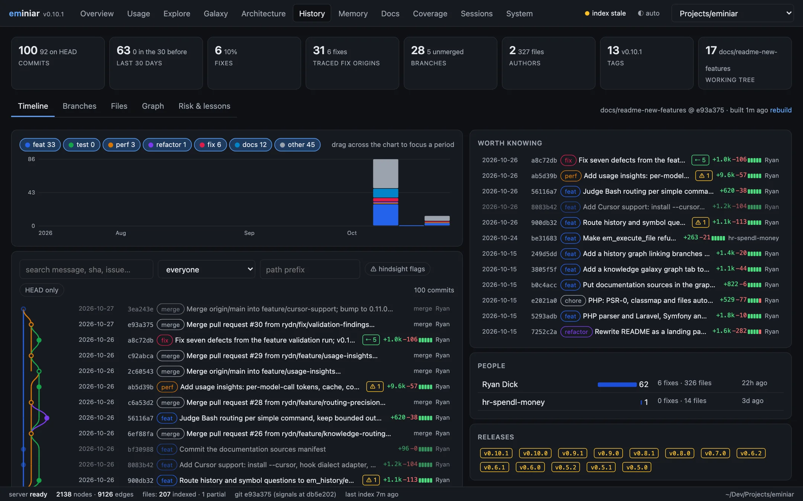
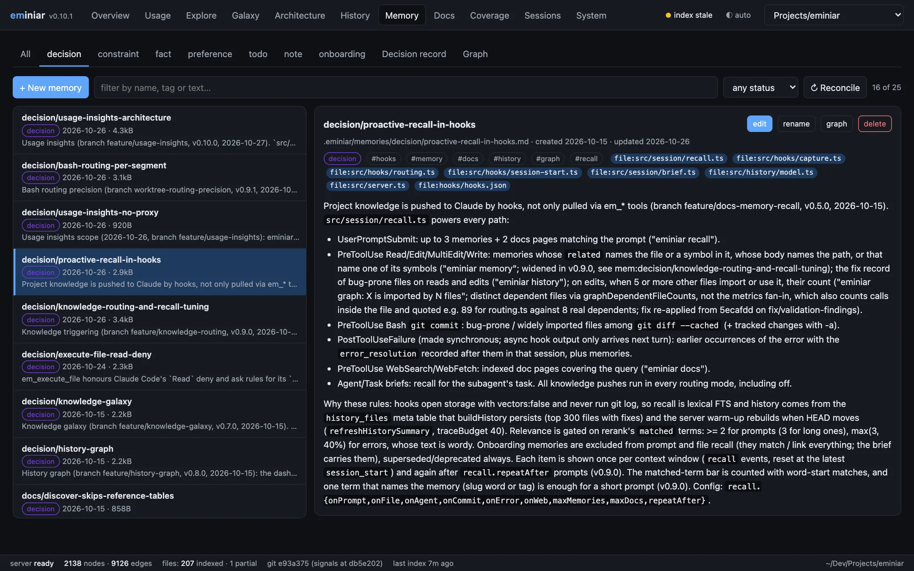
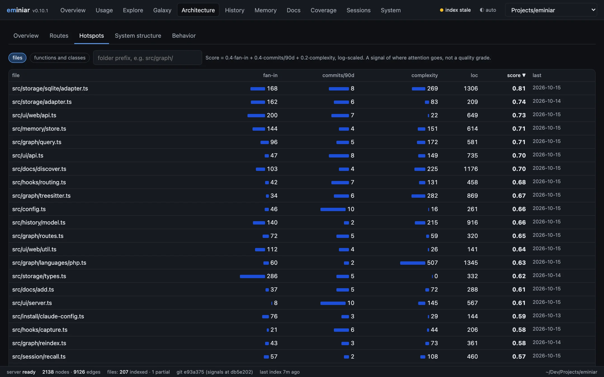

<div align="center">

# eminiar

**A memory, a code map and a clean context window for Claude Code — all on your machine.**

*Pronounced ee-MIN-ee-ar*

[](#license)
[](https://nodejs.org)
[](https://docs.claude.com/en/docs/claude-code)
[](docs/how-it-works.md#privacy-and-data)

[Quick start](#quick-start) · [Features](#what-you-get) · [How it works](docs/how-it-works.md) · [Tools](docs/tools.md) · [Docs](docs/README.md)

<br/>

<picture>
  <source media="(prefers-color-scheme: dark)" srcset="docs/images/dashboard-explore-dark.webp">
  
</picture>

<sub>The local dashboard: source, file impact and the memories linked to the file.</sub>

</div>

---

## The problem

Claude Code is very capable, but three things slow it down on a real project:

1. **The context window fills with noise.** One `git log`, test run or API response can use
   thousands of tokens. Claude needs only a few lines of it.
2. **Every session starts from zero.** Decisions, constraints and fixed bugs are lost after a
   `/compact` or a new session. Claude asks again, or repeats a mistake.
3. **Claude reads code without a map.** It does not know which files are fragile, which files
   import a function, or why a line changed.

## The solution

eminiar is a Claude Code plugin. It adds an MCP server with 22 `em_*` tools and a set of hooks.
Everything runs locally in one SQLite database per project.

| | Without eminiar | With eminiar |
|---|---|---|
| **Large output** | The full output goes into context | Output is indexed. Only the sections that match your `intent` come back |
| **Memory** | Lost at `/compact` or a new session | Markdown memories in your repo, given back to Claude when they are relevant |
| **Code structure** | `grep` and full-file reads | A knowledge graph of files, symbols, calls, routes and hotspots |
| **Git history** | Raw `git log` / `git blame` | Classified commits, with each fix traced back to the commit that caused it |
| **Library docs** | Web search on each question | A local, searchable index of the docs your project uses |
| **Getting knowledge** | Claude must remember to ask | Hooks push the relevant knowledge to Claude **automatically** |

## What you get

### 🧪 Sandboxed execution — keep raw output out of context

`em_execute`, `em_batch_execute` and `em_execute_file` run shell, JavaScript and TypeScript, plus
Python, Ruby, Go, PHP, Perl, R, Elixir, Rust and C# when they are installed. Output over 5 KB is
indexed. Claude gets back only the sections that match its `intent`. Snippets obey your Claude
Code `permissions.deny` rules.

### 🔎 Hybrid search — keyword and meaning together

SQLite FTS5 (porter + trigram, BM25, typo correction) is fused with local ONNX embeddings
(`bge-small` through `sqlite-vec`). Search covers command output, files, fetched pages,
documentation, memories, git messages and session history. It never waits for the model to
download.

### 🧠 Memory that comes back by itself

`em_remember` writes plain markdown files to `.eminiar/memories/`. You can read them, edit them
and commit them. Decisions have an ADR-style status (`proposed`, `accepted`, `superseded`). Hooks
attach matching memories to your prompts, to file reads and edits, to failed commands and to
subagent briefs. **Claude does not have to remember to look.**

### 🕸️ Code knowledge graph — a map before an edit

tree-sitter parses TypeScript, JavaScript, Python and Go into files, symbols, imports, calls,
references, inheritance and HTTP routes (Express, Fastify, Koa, hapi, Hono, Moleculer, Next.js,
Python decorator routes and Go routers). eminiar
adds fan-in, complexity, churn, a hotspot score, module clusters, import cycles and git co-change
coupling. Ask *"what breaks if I change this?"* with `em_graph_impact`.

### 📜 Git history, read for Claude

`em_history` classifies every commit (feat, fix, refactor, perf …). It traces each fix back to
the commit that wrote the broken lines. Files get a risk score with reasons. Before Claude edits
a bug-prone file, it sees the record.

### 📚 Documentation knowledge base

`em_docs` finds your local docs (READMEs, ADRs, OpenAPI, Postman) and the libraries, services
and third-party APIs your code calls. It indexes their documentation locally. OpenAPI specs are
split into one section per endpoint, so a lookup returns the exact operation.

### 📊 Local dashboard

`eminiar ui` opens a local web app with token savings, a source explorer with impact analysis, a
graph "galaxy", an architecture map, a history explorer, a memory editor and a docs manager.

| | |
|:---:|:---:|
| [](docs/dashboard.md#galaxy) | [](docs/dashboard.md#history) |
| **Galaxy:** the knowledge graph | **History:** classified commits and fix tracing |
| [](docs/dashboard.md#memory) | [](docs/dashboard.md#architecture) |
| **Memory:** decisions linked to code | **Hotspots:** where change is risky |

## What Claude sees

Hooks add short notes to the conversation at the right moment. These examples are real output:

```text
eminiar recall — project memories and indexed docs that match this request:
- memory decision/proactive-recall-in-hooks [decision]: Project knowledge is pushed to Claude by hooks …

eminiar history: src/cli.ts is bug-prone (1/6 commits were fixes; 1 earlier change later needed
fixing; last fix 3f8c697 Fix MCP registration, make enforce routing and dev upgrades safe).

eminiar graph: 32 other files import or use src/storage/adapter.ts; em_graph_impact
{node:"file:src/storage/adapter.ts"} lists them before you change an exported signature.
```

Each note appears once per context window. After a `/compact`, notes come back when they are
relevant again.

## Quick start

**Requirements:** Node.js 22.12 or later, and Claude Code.

```sh
npx eminiar install     # registers the plugin, installs a stable copy, downloads the model
npx eminiar doctor      # checks every part
```

Restart Claude Code. Then, in your project:

```text
/em-onboard             # writes onboarding memories and builds the docs knowledge base
```

That is all. Use Claude Code as usual. To see how much context eminiar saves, run `/em-stats` or
open the dashboard with `eminiar ui`.

**For a team:** run `npx eminiar install --team` once and commit `eminiar.config.json` and
`.eminiar/`. Teammates then run `npx eminiar install`. See
[Getting started](docs/getting-started.md#team-setup).

## How it works


- **Hooks** run on session start, prompts, tool calls and failures. They capture session events,
  route noisy commands to the sandbox, and attach relevant knowledge.
- **The MCP server** provides the `em_*` tools and keeps the index and graph up to date.
- **Storage** is one SQLite file per project under `~/.eminiar/`. Memories also live as markdown
  in your repo.

Read more in [How it works](docs/how-it-works.md).

## Documentation

| Guide | Contents |
|---|---|
| [Getting started](docs/getting-started.md) | Install, team setup, first steps, upgrade and uninstall |
| [How it works](docs/how-it-works.md) | Architecture, routing modes, session continuity, privacy |
| [Tools reference](docs/tools.md) | Every `em_*` tool and slash command |
| [Memory and recall](docs/memory-and-recall.md) | Memory files, decisions, automatic recall |
| [Knowledge graph and history](docs/knowledge-graph.md) | Graph, symbols, impact analysis, git history |
| [Documentation knowledge base](docs/documentation-kb.md) | Discover, index and look up docs |
| [Dashboard](docs/dashboard.md) | The `eminiar ui` web app |
| [Configuration](docs/configuration.md) | Every config key with its default |
| [CLI](docs/cli.md) | The `eminiar` command |
| [Troubleshooting](docs/troubleshooting.md) | Common problems and fixes |
| [Development](docs/development.md) | Build, test, benchmark and project layout |

## Privacy

Your code, tool output and memories stay on your machine. eminiar uses the network only to:

- download the embedding model once (you can skip this with `install --no-model`);
- fetch web pages and documentation that you or Claude ask it to index;
- look up package metadata in the npm, PyPI and Go registries when it adds documentation.

The dashboard listens on `127.0.0.1` only.

## License

MIT © Ryan Dick
