# Dashboard

[← Docs index](README.md)

```sh
eminiar ui                  # opens http://127.0.0.1:7331
eminiar ui --port 8080 --no-open
```

The dashboard is a local web app for the current project. It is one self-contained page (Preact,
d3-force, Prism) with no CDN. The theme follows your system, or you can choose light or dark.

## Tabs

### Overview

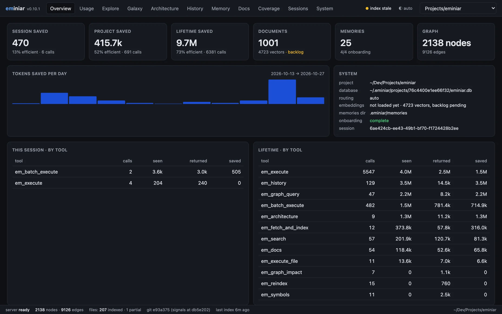

Token savings per session, per project and over your lifetime. Index and graph sizes.

### Usage

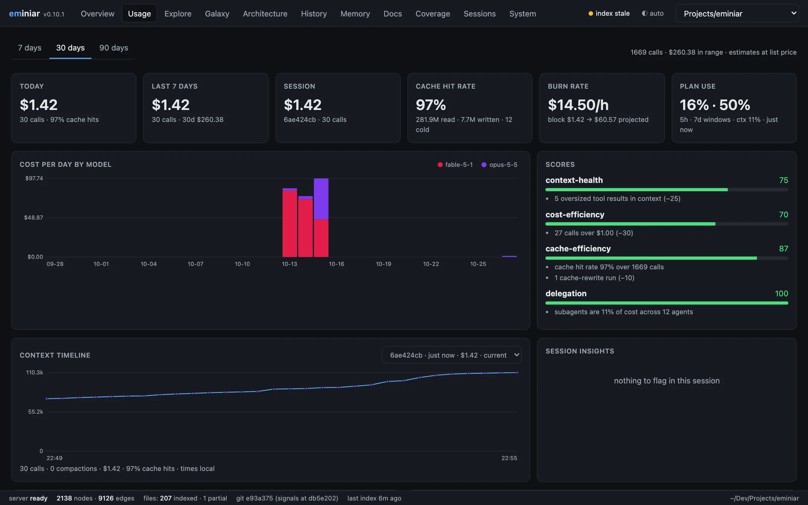

The interactive version of [`em_usage`](usage.md): what your Claude Code sessions cost, from the
transcripts on your machine.

- Tiles for today, the last 7 days, the selected session, cache hit rate, the burn rate of the
  active 5-hour block (n/a until the block has a few calls over a few minutes) and plan use
  (5-hour and 7-day windows, from the statusline, subscribers only).
- Cost per day stacked by model for the last 7, 30 or 90 days, every day of the range on the
  axis even when it had no calls. Each model id gets its own colour: the family sets the hue
  (Opus violet, Sonnet blue, Haiku green, Fable rose, other grey) and each distinct id in the
  family a lighter or darker step, with the id always written next to the swatch.
- The context timeline of one session: context tokens per API call, dots coloured by model,
  dashed markers where the context was compacted. Pick a session from the menu, or arrive from
  the **usage →** link on the Sessions tab.
- Tables of models (share of cost, tokens, unpriced models flagged), tool results in context, and
  5-hour billing blocks.
- Insights with their severity, the project-wide and the session's, and the four scores
  (context health, cost efficiency, cache efficiency, delegation) with their reasons.
- What eminiar saved, direct and compounding, with the assumptions.

Deep link: `#/usage?session=<id>&range=7d|30d|90d`.

### Explore

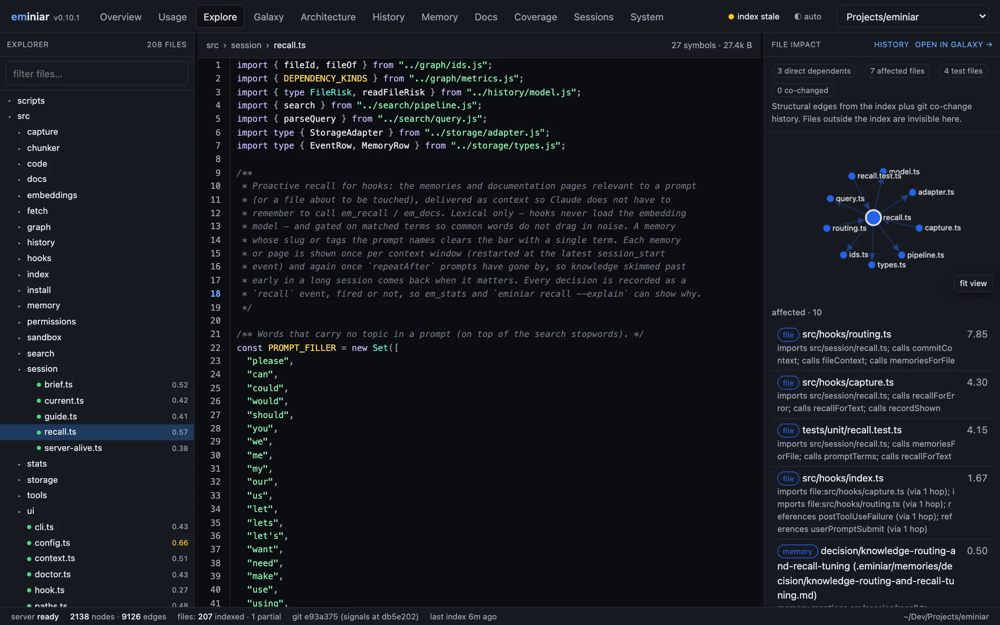

A source explorer for the project.

- **File tree** with index status and heat.
- **Source view** with syntax highlighting and a symbol gutter.
- **File impact:** dependents, affected files, tests, co-changed files and linked memories.
- **Code details** for the symbol under the cursor: callers, calls, references and metrics.

### Galaxy

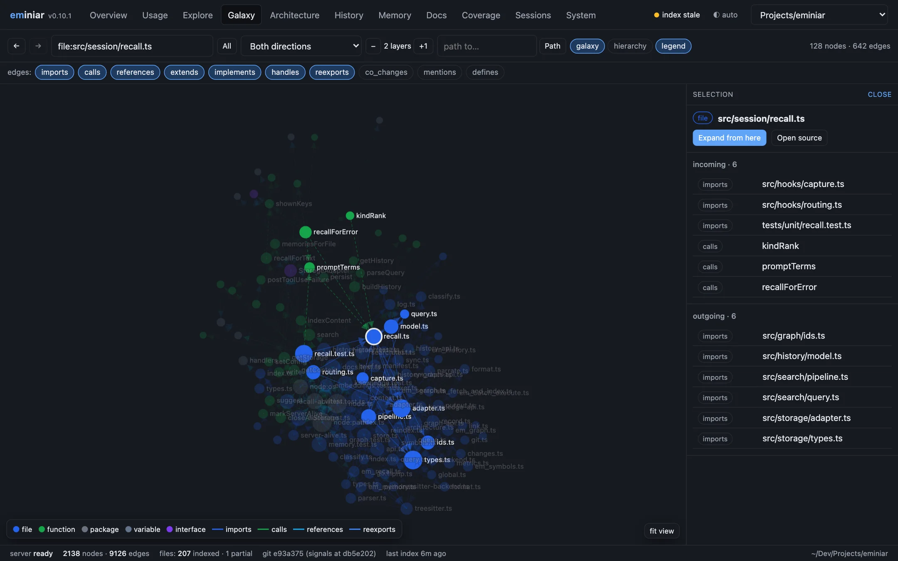

The code graph and the project's architecture, in one page with seven tabs. The tab is in the
URL (`#/galaxy?tab=<id>`), and the page reopens on the last tab you used.

- **Galaxy** (`tab=galaxy`). The knowledge graph on a canvas, force-directed. Search for a node,
  choose the direction and edge kinds, expand one layer at a time, or find a path between two
  nodes. Back and forward buttons step through your exploration. A link with `node=` opens this
  tab (`#/galaxy?node=file:src/server.ts`).
- **Hierarchy** (`tab=hierarchy`). The same graph and controls, laid out in layers.
- **Folder map** (`tab=map`). A treemap of the folders, sized by lines of code (or evenly) and
  coloured by language or by heat.
- **Routes** (`tab=routes`). The HTTP routes found in the code, with their handlers.
- **Hotspots** (`tab=hotspots`). The files and functions that attract change: fan-in, commits in
  the last 90 days, complexity and the hotspot score.
- **Structure** (`tab=structure`). Module clusters and their import cycles.
- **Behavior** (`tab=behavior`). A tree of the calls that one operation can make.

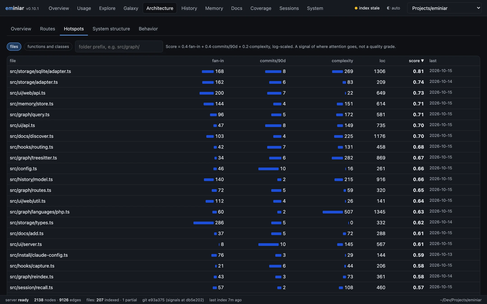

The five tabs after Hierarchy were once a separate Architecture page. Old `#/architecture`
links still work: they open Galaxy on the same tab (`#/architecture?tab=hotspots` →
`#/galaxy?tab=hotspots`), and the old overview, or no tab, opens the Folder map.

### History

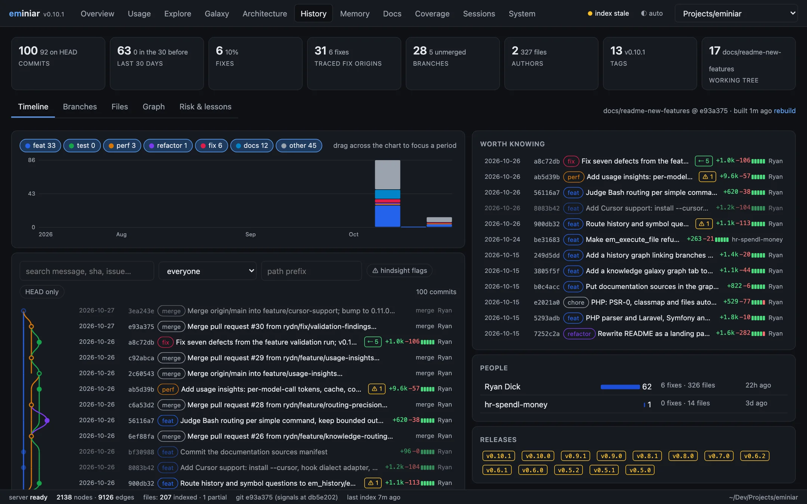

The interactive version of [`em_history`](knowledge-graph.md#git-history).

- Weekly activity by commit kind, with a brush to select a time range.
- The commit graph (DAG) with branch lanes.
- A scatter plot of churn against fix share, to find fragile files.
- The story of one file.
- Branch comparison.
- The lessons the history teaches: changes that later needed fixing.

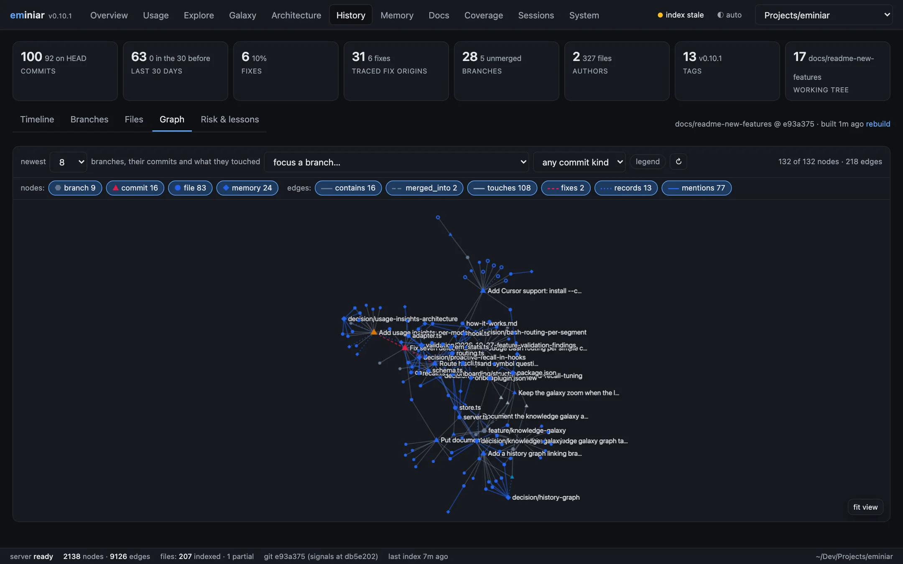

The **Graph** tab links the history to the knowledge base. Branches (hexagons) point at their
own commits (triangles, coloured by commit kind), commits at the files they changed, and those
files at the memories (diamonds) and doc sources (squares) about them. A commit that wrote or
edited a memory points straight at it (`records`), a fix points at the commit its removed lines
trace back to (`fixes`), and a merged branch points at the default branch (`merged_into`).

A branch's commits are its first-parent chain down to the default branch's first-parent line.
That way a branch merged with a merge commit keeps its commits after main moves on. Branches
deleted after merging are recovered from the merge subjects (`Merge pull request #12 from
owner/feature/x`, `Merge branch 'x'`).

Without a focus the tab draws the newest branches (5, 8, 15 or 30). Pick a branch from the
menu, or press **Focus here** on any node, to re-centre on a branch, commit, file, memory or doc.
The **Graph** buttons on a commit, a branch and a file's history open the same view. Chips
switch node and edge kinds off, and a commit-kind menu keeps only feats, fixes, and so on.
Lockfiles are left out, and each commit shows its 12 biggest file changes.

### Memory

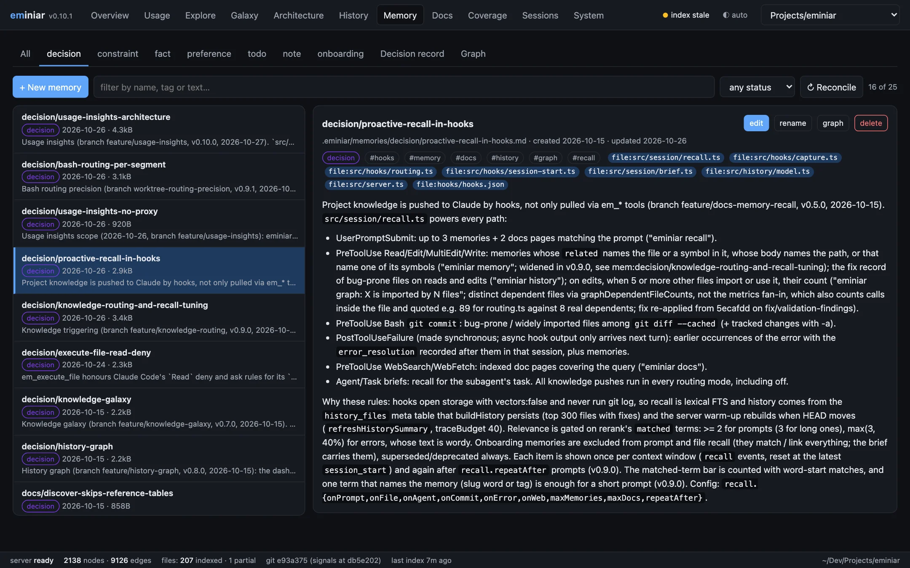

Browse and edit `.eminiar/memories`. Shows decision status and `supersedes` links, and compiles
a decision record.

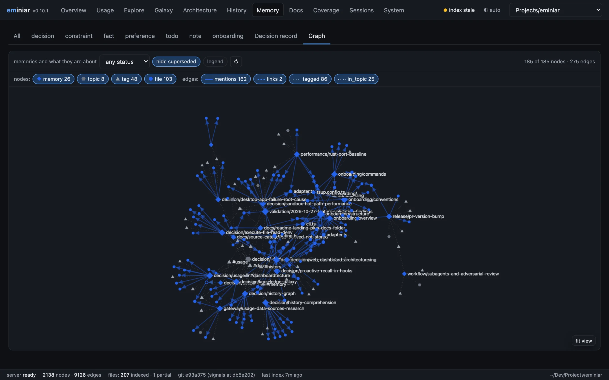

The **Graph** tab is a knowledge galaxy: memories (diamonds), the files they mention, the
memories they link to, and hub nodes for tags (triangles) and topics (hexagons). Chips switch
node and edge kinds off, a status filter and a "hide superseded" toggle narrow the decisions, and
a hollow ring marks something referenced that no longer exists. Double-click a node, or use
**Focus here**, to centre on it (`#/memory?tab=graph&focus=file:src/x.ts`).

### Docs

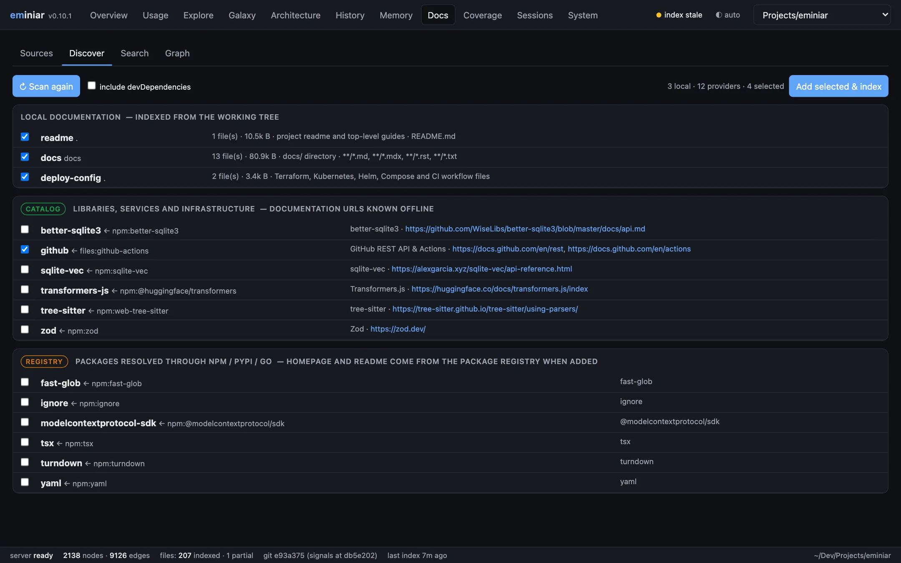

Documentation sources with their pages and sync state. Add a source by URL, path or provider. A
discovery screen lists local docs, catalogue providers, APIs found in code, registry packages
and unknown hosts (with a field for a URL). It also has a docs-only search.

The **Graph** tab draws each source (squares) with the packages it documents, the code files
its local pages name, its category, and the memories about its pages, with a category filter
(`#/docs?tab=graph&focus=doc:zod`).

### Coverage

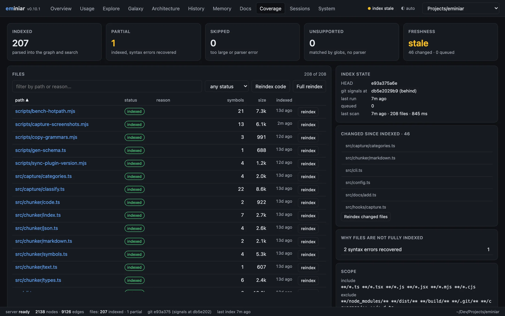

Files that are indexed, partly indexed, skipped or unsupported, each with the reason. Freshness
against `HEAD` and the working tree. Reindex one file.

### Sessions and System

Session event timelines (each session links to its usage), maintenance actions, doctor checks
and the index-run log.

### Swarms

A live monitor for [agent swarms](swarms.md), the opt-in feature that runs a team of
Claude Code subagents from `.eminiar/swarm.yaml`. Every state is written as a glyph and a word,
so colour is never the only cue: ○ pending or idle, ● running or active, ◆ blocked, ✓ done,
✗ failed, ◌ stale (running but silent for 15 minutes), ★ the coordinator (your main session).

The tab has two pages, switched in the sub-nav at the top. **Runs** (`#/swarm`) is the live
monitor described below. **Configure** (`#/swarm/config`) is the [configuration studio](#configure),
a visual editor for `.eminiar/swarm.yaml`. On Configure, the sub-nav shows a count of the swarm
file's issues. Beside the sub-nav sit the file path and a file-state badge: not opted in, file
invalid, disabled, agent files out of date, or enabled and in sync. The state is re-read every
15 seconds.

- **Run header.** A band with the run's goal, a state pill, the swarm and its topology, and a
  **Finish run** button while the run is active. Two rings show tasks done (as a percentage) and
  workers running against the `max_agents` limit. A stat row follows: a task bar (done, active,
  and failed or blocked), tool calls with a per-minute sparkline, the error rate (the share of
  tool calls that failed), and a live elapsed counter. The finish form closes an active run as
  done, failed or cancelled, with an optional summary. It can also write the outcome as a project
  memory.
- **Topology.** The coordinator hub with one node per worker, showing role, short agent id,
  status and task. Hierarchical swarms draw as a tree from the hub, mesh as a ring with peer
  links, and pipeline as left-to-right stage lanes. A role with no worker yet shows as an idle
  ghost node. Motion means data. A running worker glows. Each tool call flashes its node: blue
  for reads, amber for writes, purple for commands. A comet travels along an edge for ten seconds
  after a claim, post or report. Click a worker to open it and filter the activity feed to it.
  With `prefers-reduced-motion`, the glow, comets and flashes are drawn as static rings. The
  topology and the Workers panel are stacked, and sit side by side only when the area is at least
  1500 px wide.
- **Workers.** One card per worker with its task, last tool, call and error counts and a
  heartbeat (time since its last event). A running worker silent for a while gets a **quiet**
  badge, and a stale one also gets **Release**, which returns its task to pending. Finished
  workers are folded after the newest few. Click a card to open a drawer with the role's model
  or model range, tools and scope, the tasks the worker held, its spawn prompt, and its last 50
  events.
- **Task board.** Pending, active, done, and failed or blocked columns. Each card shows the
  task id, role, holder, file count and dependencies. Hovering a card shows the result. A card
  closed from a worker's final message, because the worker never reported, carries an
  **auto-closed** badge so you can check it and reopen it. Click a card to see the detail, the
  full result and the files.
- **Timeline.** Busy segments per worker over the run, coloured by the kind of tool calls.
  Events less than a minute apart merge into one segment.
- **Activity feed.** The run's events, newest first, in monospace, with a role chip and a glyph
  per kind. You can filter by role or kind (tool calls, tasks, blackboard, workers, run, errors).
- **Blackboard.** The shared notes with key, author, version and age. Click a note to read its
  value.
- **Adjudicator decisions.** Each task card and worker card shows a `model · effort` chip for what
  actually ran, with a `≠` and an amber outline when it differs from the adjudicator's suggestion.
  An effort of `default` means the agent file's own setting ran and the level is not known (older
  rows, or no effort passed). The worker drawer has a **Decision** section: ran at, suggested
  (model, effort, confidence), the outcome (followed, overrode, pinned, forced, fork or none) in a
  sentence, and the top reasons. The run snapshot carries `decisions` keyed by task id. With the
  adjudicator off, or before a task is dispatched, the chip is absent and the drawer says so.
- **Left rail.** A **Swarms** card lists the configured swarms: topology, role count, slots
  against `max_agents`, and role chips in a colour per role. A badge shows how many agent files
  need a sync. Click a swarm, or the **Configure** link, to edit it. **Sync agent files**
  rewrites `.claude/agents/swarm-*.md`. Below the card are the runs, each with its status, goal,
  age and task progress, filtered by all, active, done or failed (which includes cancelled). Click
  a run to open it (`#/swarm?run=<id>`). With no run selected, the newest active run opens.

While a run is active and the tab is visible, new events are polled every 2 seconds and the
snapshot every 5. Otherwise the run list refreshes every 15 seconds.

With no runs yet, the page says so and shows the command to start one
(`/eminiar:em-swarm <swarm> <goal>`) with a preview of each swarm. Without a swarm file, the
tab explains the feature, shows the starter file read-only, and offers a **Create
from the starter** button, which writes `.eminiar/swarm.yaml`, and the command `eminiar swarm init`. An invalid file lists its
errors with their line numbers and a Configure link. A file with `enabled: false` shows "Swarms
are disabled", because the hooks ignore the swarms until it is switched back on.

API (JSON, loopback only):

| Route | Returns |
|---|---|
| `GET /api/swarm` | state (`absent`, `invalid` or `ok`), swarms and roles with agent-file state, issues, recent runs with counts, the starter YAML when absent |
| `GET /api/swarm/run?id=` | the run, tasks, workers (status derived), notes, the latest events, counts and per-worker timeline segments, plus the adjudicator's `decisions` for the run's tasks. `tasksSince=<ms>` sends only the tasks updated since then, `events=0` leaves the events out. Long task text is cut |
| `GET /api/swarm/task?id=&run=` | one whole task, with its full `detail` and `result` and the adjudicator's `decision` for it. `run` is optional and must match the task's run |
| `GET /api/swarm/events?id=&after=` | up to 200 events after an event id, oldest first, with `last` and `more` for the next page |
| `POST /api/swarm/init` | writes the starter file if none exists (409 otherwise) and syncs the agent files |
| `POST /api/swarm/sync` | syncs the agent files with the swarm file |
| `POST /api/swarm/release` | `{id, agent}`, returning a stale worker's task to pending |
| `POST /api/swarm/finish` | `{id, status: done\|failed\|cancelled, summary?, remember?}`, closing the run as the coordinator |

Run ids look like `20261028-a1b2c3`. Anything else is a 400, and an unknown run is a 404.

#### Configure

`#/swarm/config` edits the swarm file without hand-writing YAML. Deep-link parameters:
`?swarm=<name>` picks a swarm, `&role=<name>` opens that role's drawer, and `&tab=settings`
shows the file-level settings.

- **Swarm editor.** Description, topology (a picker with a small preview), `max_agents`, stages
  and instructions, with a live topology preview that warns when the roles' counts exceed
  `max_agents`.
- **Role cards and drawer.** Each role is a card. Its drawer edits the description, prompt,
  tools, disallowed tools, skills, count, isolation, turn limit, effort, colour, scope, memory
  tags, context and model policy.
- **Model policy.** Each role is in one of three states. *Default* inherits the file's
  `defaults.model_range`. *Pin* gives the role one fixed `model`, so the adjudicator never
  changes it. *Range* sets the role's own floor and ceiling, and the adjudicator picks a model
  inside that range per task. The control rejects a fallback model outside the range.
- **Settings.** The file-level `enabled`, `sync`, `enforce`, `allowed_agents` and `defaults`.
  Turning on `enforce` or `enabled: false` asks for confirmation first.
- **Templates.** **＋ New swarm** opens a gallery (feature, review, research, bugfix, docs,
  blank). With no file yet, an onboarding page offers **Start from the annotated starter**.
- **Raw YAML.** **Raw YAML** switches to a text editor, and **Show YAML** / **Hide YAML** shows
  the rendered file beside the form. Fields the form cannot edit safely (YAML anchors and
  aliases, merge keys, `x-*` keys and every role's `hooks`) are read-only with an **Edit in
  YAML** link.
- **Save.** Changes are validated by the server as you type (after a 350 ms pause). **Save**
  writes the file, **Save & sync** also rewrites `.claude/agents/swarm-*.md` (it reads **Sync
  agent files** when nothing is dirty but the agent files are out of date), and **Revert**
  drops the draft. Leaving with unsaved changes prompts. If the file changed on disk meanwhile,
  a banner offers **Reload from disk** or **Keep mine**, which rebases your draft onto the
  current file.
- **Warnings.** Saving is allowed but warns when a rename or removal touches a role that an
  active run uses, or when roles exceed `max_agents`.

Config API:

| Route | Returns |
|---|---|
| `GET /api/swarm/config` | state, file path, text and hash, parsed document, issues, warnings, locked paths, active runs, and the editor's choices and limits |
| `GET /api/swarm/templates` | the starter templates with their roles and models |
| `POST /api/swarm/config/validate` | `{doc\|text, renames?, baseHash}`: the rendered text, issues, warnings and changed lines. Never writes |
| `POST /api/swarm/config/save` | `{doc\|text, renames?, baseHash, sync?}`: writes the file and returns the new hash, text and the sync result |

Send exactly one of `doc` and `text`. `baseHash` is the SHA-256 of the file you started from,
or `null` to create it. Status codes:

| Status | Meaning |
|---|---|
| 400 | the body or the resulting file is invalid; `issues` lists each problem with its path |
| 403 | the target location is refused (outside the project, or a symlink) |
| 405 | the method is not allowed for the route |
| 409 | the file changed on disk since `baseHash`, or you tried to create over an existing file; `current` holds the on-disk text and hash |
| 422 | the edit touches a locked path, or the existing YAML does not parse in structured mode (use raw mode) |

Write safety: the server writes only `.eminiar/swarm.yaml`, never a path from the client. The
path must stay inside the project, with no symlink in the way. The file is re-read and compared
with `baseHash` right before the write, then replaced atomically through a temp file and
rename. The rendered text must pass the same validation as `eminiar swarm`, and `enforce` must
read the same to the hook.

The first structural save re-serialises the file. Comment text survives, but trailing comments
can be re-aligned or move onto their own line, and comments on items inside a list that is
replaced are lost. Editing a single scalar changes only that line.

#### Design-system components

The dashboard's shared building blocks live in `src/ui/web/ds.tsx`: `Hero`, `Stat` and
`StatRow`, `Badge`, `Pill`, `Card`, `Gauge`, `Sparkline`, `SegBar`, `ColumnChart`, `Skeleton`,
`Segmented`, `Drawer`, `Field`, `Stepper`, `ChipInput`, `Switch` and `EmptyState`. The Overview,
Runs and Configure views use them, so tones, spacing and the glyph-plus-word state cues stay
the same everywhere.

### Playbooks

The library of [playbooks](tools.md#playbooks): stored recurring tasks. The dashboard shows and
edits them; it never runs one.

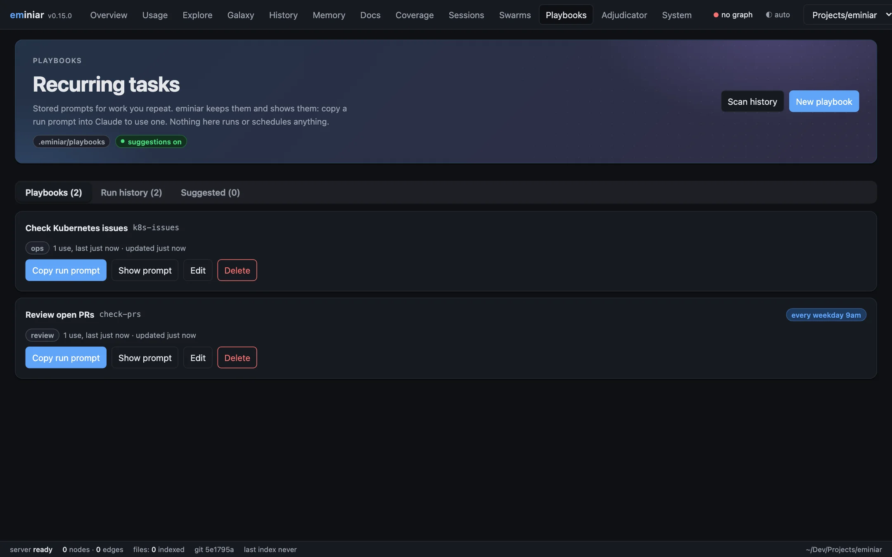

- **Playbooks** lists each one with its title, tags, schedule hint, a private or suggested badge
  and how often it was used. Show prompt reveals the prompt, with a field per parameter.
  **Copy run prompt** copies the filled prompt to paste into Claude and records one use. Edit and
  Delete appear when `playbooks.adding` is on; New playbook creates one.
- **Run history** lists the recorded runs: when, which playbook, the status and how it started.
  A run still `started` has done, failed and skipped buttons (with `playbooks.adding` on) to
  report how it ended; a closed run is not changed.
- **Suggested** (only with `playbooks.extraction.enabled`) is the inbox of tasks eminiar found
  you repeat. Each shows its evidence and prompt, with Accept and Dismiss. Nothing becomes a
  playbook until you accept it, and a dismissed suggestion is not proposed again.
- **Scan history** looks through your session history for recurring tasks and lists what it
  found without saving anything. Save as suggestions files them in the inbox; Cancel discards.

The section is in the address (`#/playbooks?tab=history`, `suggested`), so a link, reload, Back
and Forward keep it. Leaving the page with an edited, unsaved playbook form asks first.

With `playbooks.viewing` off the tab says playbooks are turned off. The tab changes files in
`.eminiar/playbooks/`, so review them in version control like any other change.

### Adjudicator

What the opt-in [adjudicator](adjudicator.md) decided, whether its advice was followed, and what
it saved. The config is read again on every request, so `eminiar adjudicator enable` shows up
without restarting the dashboard. The range switch (7d, 30d, 90d, all; default 30 days) applies
to the whole tab.

- **Off.** While the adjudicator is off, the tab explains what it does, its privacy model and
  `eminiar adjudicator enable`, and offers the try-it box (heuristic only) and the last eval
  report. Decisions recorded while it was on are still shown.
- **Tiles.** Decisions by surface; advice followed, with the apply and respect rates; the
  fallback rate with the provider statuses behind it; provider latency p50 and p95, and end to
  end; the adjudicator's own spend; net savings, with a **how is this computed?** link that
  lists the assumptions.
- **Decisions per day**, stacked by where the verdict came from: heuristic, blend, cache or
  fallback (UTC days).
- **Provider card.** Configured and effective provider and why they differ, mode, key source
  (`env`, `file` or `none`; never the key), consent, apply effectiveness ("n of m"), and per
  provider the breaker state, retry time, last error class, p50/p95 latency and today's spend
  against the daily cap. A rejected key shows as "API key rejected".
- **Complexity** histogram (0 trivial to 4 very complex) and a **suggested tier × model that
  ran** heatmap for dispatches and plan tasks.
- **Call log.** Paged, filterable by surface, provider and outcome. Each row shows the stored
  80-character redacted head of the input. Click a row to open the decision drawer: the
  features, the tier, tool and role tables as bars split into heuristic, provider and learned
  parts with their reasons, the complexity terms, the blend weights and bias, the provider
  status, latency and tokens, and the outcome with the actual model, tokens and savings.
- **Savings.** Realised, potential, spend and net, the assumptions, and tokens per successful
  task by tier.
- **Try it.** Paste a prompt or task to score it. The provider is used only when the
  adjudicator is on, you tick the box, and the provider has its consent and key. Nothing is
  stored and the text is not sent back, but a provider call counts against the daily caps.
- **Last eval.** The report saved by `eminiar adjudicator eval --save`.

Links: `#/adjudicator?range=7d` and `#/adjudicator?id=<decision id>` (opens the drawer).

API (JSON, loopback only). The GETs that read decisions first link new outcomes
(reconcile, up to 500 rows). No payload contains a key or a masked key. Input text beyond the
stored 80-character head appears only in the two Jev request routes, and only when you turned on
[Jev request capture](adjudicator.md#jev-request-capture).

| Route | Returns |
|---|---|
| `GET /api/adjudicator?since=` | on/off, mode, the sanitised config, configured and effective provider, key source, consent, provider health, apply effectiveness, the summary, the fallback rate and the chart data (default `since=30d`) |
| `GET /api/adjudicator/decisions?since&surface&provider&outcome&limit&offset` | decision rows without score tables (`limit` 1–500, default 50) |
| `GET /api/adjudicator/decision?id=` | one decision with its parsed score tables |
| `GET /api/adjudicator/savings?since=` | realised, potential, spend, net, assumptions, tokens per successful task by tier, the tier matrix |
| `GET /api/adjudicator/eval` | the last saved eval report, or `null` |
| `GET /api/adjudicator/jev?since=&surface=` | the Jev impact report (only when the adjudicator is on with the `typesafe` provider; otherwise `{active:false, reason}` without reading the database; `surface` is `prompt`, `agent`, `plan`, `mcp` or `tool`; like the other tab reads it first settles pending outcomes, at most 500 rows, and carries on if that fails; the result is in `reconcile`) |
| `GET /api/adjudicator/jev/exchanges?limit=&row=` | the newest captured Jev requests without bodies: time, result, timing, items, tokens, decision ids (`limit` 1–100, default 100; `row` = only those that served that decision). `{active:false}` as for `/jev`, and `{capture:false}` when capture is off; neither reads the database |
| `GET /api/adjudicator/jev/exchange?id=` | one captured request with the request and response bodies (redacted) and its error |
| `POST /api/adjudicator/test` | `{text (1–20000 chars), useProvider?}`: a verdict that is never stored |

#### Jev impact

Inside the Adjudicator tab, under the tiles, when the adjudicator is **on** and its provider is
`typesafe` (TypeSafe Jev). With any other provider, or the adjudicator off, the section is not
rendered at all and the tab makes no `/api/adjudicator/jev` request. (A tab that was already open
when you turned Jev off can still send one request on its next refresh; the server answers
`{active:false}` without reading the database, and the section goes away.) If Jev is configured but
cannot be called (no key, no consent), the section stays and shows a banner saying every
decision falls back to the heuristic. It uses the tab's range switch and refresh button.

It answers "is Jev changing what the heuristic would have chosen, and did that help?" from rows
the adjudicator already records, with nothing re-scored and no prompt text read. Each load first
settles pending outcomes like the other tab reads, which writes outcomes and updates the learned
bias; the response carries that result in `reconcile`, so a failed settle is visible.

- **Verdict**, with its sample size and the rule behind it (**how is this decided?**):
  *helping* when the 90% lower bound of help ÷ (help + hurt), over dispatches Jev changed, is
  above 50%; *hindering* when the upper bound is below 50%. It says **not enough data** and why
  below 10 labelled outcomes, below 30 compared plan or agent decisions that Jev answered inline
  (prompts and cache hits are not counted), when the labelled outcomes come from fewer than 3
  different swarm runs or sessions, or when the evidence is split.
  Warnings (Jev failing often, a degraded provider, blending that created near-ties, negative
  net, an open breaker, deferred async prompts, mixed brief eras, missing usage data) are shown
  in amber and never change the label.
- **Tiles.** Share of decisions where Jev changed the tier (up and down, uncertain and deferred
  counts); share of dispatches whose effective model changed; Jev calls with failure rate, p50
  and breaker; Jev spend with cost per call and the wait it adds at p50; net from Jev's changes
  (list prices, minus Jev's spend).
- **Heuristic → final tier.** A grid of the heuristic's tier against the tier with Jev; the
  outlined diagonal is agreement. The heuristic's pick is reconstructed from the stored blend
  table, so near-ties are left out as uncertain. Below it: how often the heuristic overruled
  Jev, and tiers rounded up for low confidence only because of blending.
- **Agreement.** Per surface, then role, tool (tools move only through Jev's needs-plan boost),
  effort and complexity.
- **Outcomes: changed vs unchanged.** Dispatches where Jev changed the effective model against
  those where it did not: advice followed, success rate (over success + failure), and feedback
  counts.
- **Evidence.** The newest labelled outcomes on dispatches Jev changed, as help, hurt or
  neutral, with the move and why. Click an id to open the decision drawer. Only dispatches that
  ran the tier Jev advised count: a downgrade that finished is help and one that failed is hurt;
  an upgrade counts only through your feedback (`em_adjudicate`), because finishing on the bigger
  model does not show the smaller one would have failed. Left out, and why:
  - Dispatches that ignored the advice or passed no model; their feedback is left out too,
    because it judges the model that ran, not Jev's.
  - Outcomes that are not final yet.
  - Dispatches where today's apply bounds, or the defaults (haiku to opus), would clamp the
    heuristic's tier: the dispatch-time bounds are not stored, so it cannot be told whether Jev or
    the bound set the model. Known limitation: a dispatch that ran under a narrower ceiling that
    has since been removed can still be read as changed.
  - Uncertain near-ties.
- **Footer.** Provider and inline latency, deferred and timed-out calls, provider models and
  how many briefs were scored per statement.

Async prompt rows (the heuristic's advice was shown first, Jev's answer arrived later) count
only as "would have changed", never as outcomes.

#### Jev requests

Below the impact panel (and shown even when it has no decisions), a **Jev requests** table lists
the newest 100 requests sent to Jev, when [capture](adjudicator.md#jev-request-capture) is on. It
does not follow the range switch. Newest first, one row per HTTP request:

| Column | Shows |
|---|---|
| time | how long ago (hover for the exact time); click to open the request |
| surface | `prompt`, `agent`, `plan` or `mcp` |
| result | `200`, `timeout`, `429 rate limited`, `http 5xx` or `invalid` |
| duration | the total time, with a thin bar against the deadline (red when it timed out) |
| wait | the wait before sending, plus `job +Xms` when a background job queued first |
| tries | attempts, with `↻ 120 ms` when a retry waited |
| items | prompts or briefs in the request |
| tokens | in / out |
| decisions | the decisions the request served; click one to open its drawer |

Above the table a notice always says what it holds: "Contains your redacted prompt text: each row
is the exact request sent to api.typesafe.ai (redacted, up to privacy.maxChars characters per
item) and Jev's answer, stored in this project's local database. Only the newest 100 are kept."
It ends with the command that deletes them, `eminiar adjudicator exchanges purge --yes`.

Click a row for the drawer (Esc closes it). **Timing** is one bar of the time in order: job wait
(background prompts only), wait before send, to first byte, body read and retry wait, with a
marker at the deadline, then a list of the send time, waits, attempts, deadline, engine budget,
whether it timed out and the HTTP status. **Request** and **Response** show the target, model,
the body's length in characters and the body as formatted JSON (raw text if it was cut at 65,536
characters), each with a Copy button; the response also shows tokens, cost and any error. All of it is shown as text, never as HTML.

With capture off the section says so and how to turn it on (`eminiar adjudicator exchanges on`,
a personal setting that a project's `eminiar.config.json` cannot set). With capture on and
nothing stored yet it says "Capture is on. No request has gone to Jev since. Prompt scoring runs
in the background, so a request appears when that job finishes." Like the impact panel, it is
not rendered, and nothing is fetched, unless the adjudicator is on with the `typesafe` provider.

## Deep links

Views have hash routes, so you can bookmark or share a link to a view:

```text
http://127.0.0.1:7331/#/explore?file=src/server.ts
```

## Security

- The server answers loopback hosts only (`127.0.0.1`, `localhost`, `[::1]`).
- The API answers the dashboard itself only: a request another site or another local port
  makes (a link, an ``, a form or a fetch, which the browser marks `Sec-Fetch-Site:
  cross-site` or `same-site`) gets a 403, GETs included. Browsers too old to send
  `Sec-Fetch-Site` (Safari before 16.4) are covered for writes only.
- `doctor --fix` from the System tab is a POST.
- Every request that writes needs a JSON content type and a loopback `Origin`.
- File reads are checked to stay inside the project root, and the file viewer refuses a file that
  a Claude Code `Read` deny or `ask` rule matches, checked as `em_execute_file` does.

`eminiar serve` is an older name for the same server. It does not open the browser unless you
pass `--open`.
