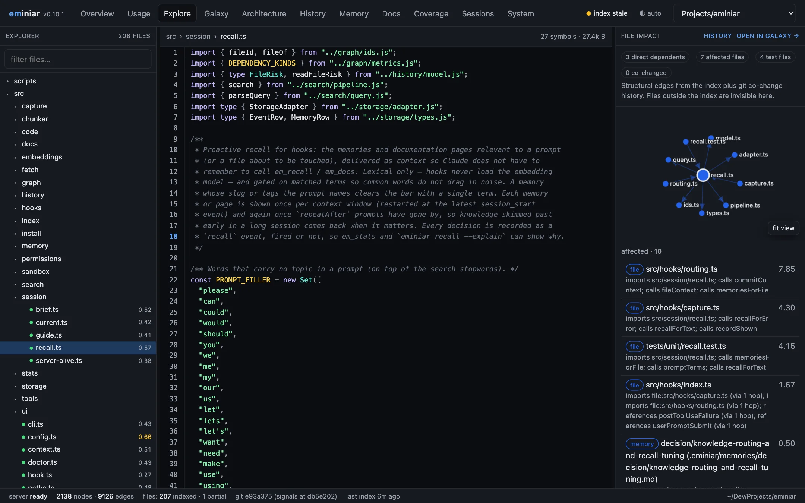
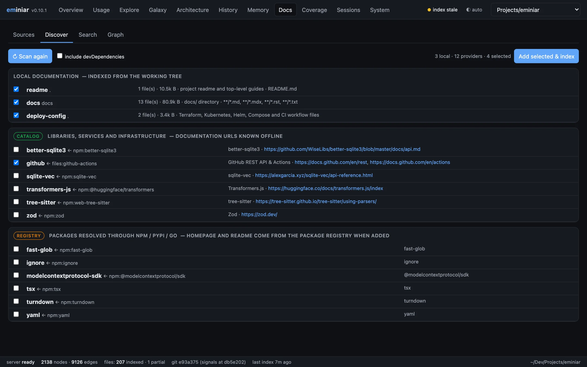
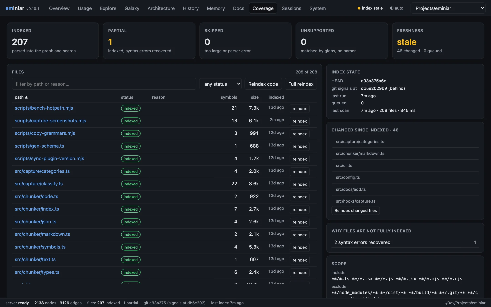

# Dashboard

[← Docs index](README.md)

```sh
eminiar ui                  # opens http://127.0.0.1:7331
eminiar ui --port 8080 --no-open
```

The dashboard is a local web app for the current project. It is one self-contained page (Preact,
d3-force, Prism) with no CDN. The theme follows your system, or you can choose light or dark.

## Tabs

### Overview


Token savings per session, per project and over your lifetime. Index and graph sizes.

### Usage


The interactive version of [`em_usage`](usage.md): what your Claude Code sessions cost, from the
transcripts on your machine.

- Tiles for today, the last 7 days, the selected session, cache hit rate, the burn rate of the
  active 5-hour block (n/a until the block has a few calls over a few minutes) and plan use
  (5-hour and 7-day windows, from the statusline, subscribers only).
- Cost per day stacked by model for the last 7, 30 or 90 days, every day of the range on the
  axis even when it had no calls. Each model id gets its own colour: the family sets the hue
  (Opus violet, Sonnet blue, Haiku green, Fable rose, other grey) and each distinct id in the
  family a lighter or darker step, with the id always written next to the swatch.
- The context timeline of one session: context tokens per API call, dots coloured by model,
  dashed markers where the context was compacted. Pick a session from the menu, or arrive from
  the **usage →** link on the Sessions tab.
- Tables of models (share of cost, tokens, unpriced models flagged), tool results in context, and
  5-hour billing blocks.
- Insights with their severity, the project-wide and the session's, and the four scores
  (context health, cost efficiency, cache efficiency, delegation) with their reasons.
- What eminiar saved, direct and compounding, with the assumptions.

Deep link: `#/usage?session=<id>&range=7d|30d|90d`.

### Explore



A source explorer for the project.

- **File tree** with index status and heat.
- **Source view** with syntax highlighting and a symbol gutter.
- **File impact:** dependents, affected files, tests, co-changed files and linked memories.
- **Code details** for the symbol under the cursor: callers, calls, references and metrics.

### Galaxy


The knowledge graph on a canvas. Search for a node, choose the direction and edge kinds, expand
one layer at a time, find a path between two nodes, or switch to a folder hierarchy. Back and
forward buttons step through your exploration.

### Architecture


- Folder treemap, sized by code size or coloured by heat.
- Routes with their handlers.
- Hotspot table (shown above).
- Clusters with their import cycles.
- A behaviour tree of the calls that an operation can make.

### History


The interactive version of [`em_history`](knowledge-graph.md#git-history).

- Weekly activity by commit kind, with a brush to select a time range.
- The commit graph (DAG) with branch lanes.
- A scatter plot of churn against fix share, to find fragile files.
- The story of one file.
- Branch comparison.
- The lessons the history teaches: changes that later needed fixing.


The **Graph** tab links the history to the knowledge base. Branches (hexagons) point at their
own commits (triangles, coloured by commit kind), commits at the files they changed, and those
files at the memories (diamonds) and doc sources (squares) about them. A commit that wrote or
edited a memory points straight at it (`records`), a fix points at the commit its removed lines
trace back to (`fixes`), and a merged branch points at the default branch (`merged_into`).

A branch's commits are its first-parent chain down to the default branch's first-parent line.
That way a branch merged with a merge commit keeps its commits after main moves on. Branches
deleted after merging are recovered from the merge subjects (`Merge pull request #12 from
owner/feature/x`, `Merge branch 'x'`).

Without a focus the tab draws the newest branches (5, 8, 15 or 30). Pick a branch from the
menu, or press **Focus here** on any node, to re-centre on a branch, commit, file, memory or doc.
The **Graph** buttons on a commit, a branch and a file's history open the same view. Chips
switch node and edge kinds off, and a commit-kind menu keeps only feats, fixes, and so on.
Lockfiles are left out, and each commit shows its 12 biggest file changes.

### Memory


Browse and edit `.eminiar/memories`. Shows decision status and `supersedes` links, and compiles
a decision record.


The **Graph** tab is a knowledge galaxy: memories (diamonds), the files they mention, the
memories they link to, and hub nodes for tags (triangles) and topics (hexagons). Chips switch
node and edge kinds off, a status filter and a "hide superseded" toggle narrow the decisions, and
a hollow ring marks something referenced that no longer exists. Double-click a node, or use
**Focus here**, to centre on it (`#/memory?tab=graph&focus=file:src/x.ts`).

### Docs



Documentation sources with their pages and sync state. Add a source by URL, path or provider. A
discovery screen lists local docs, catalogue providers, APIs found in code, registry packages
and unknown hosts (with a field for a URL). It also has a docs-only search.

The **Graph** tab draws each source (squares) with the packages it documents, the code files
its local pages name, its category, and the memories about its pages, with a category filter
(`#/docs?tab=graph&focus=doc:zod`).

### Coverage



Files that are indexed, partly indexed, skipped or unsupported, each with the reason. Freshness
against `HEAD` and the working tree. Reindex one file.

### Sessions and System

Session event timelines (each session links to its usage), maintenance actions, doctor checks
and the index-run log.

### Swarms

A live monitor for [agent swarms](design/agent-swarms.md), the opt-in feature that runs a team of
Claude Code subagents from `.eminiar/swarm.yaml`. Every state is written as a glyph and a word,
so colour is never the only cue: ○ pending or idle, ● running or active, ◆ blocked, ✓ done,
✗ failed, ◌ stale (running but silent for 30 minutes), ★ the coordinator (your main session).

- **Left rail.** The configured swarms: topology, description, and role chips in a colour per
  role. Each chip shows the state of its generated agent file (in sync, missing, stale, or a
  conflict with a hand-written file of the same name). Validation errors are listed with their
  line numbers. **Sync agent files** rewrites `.claude/agents/swarm-*.md`. Below that are the
  runs, each with its status, goal, age and task progress. Click a run to open it
  (`#/swarm?run=<id>`). With no run selected, the newest active run opens.
- **Stat tiles.** Workers running (out of `max_agents`), tasks done out of total, tool calls,
  errors and elapsed time.
- **Topology canvas.** The coordinator hub with one node per worker, showing role, short agent
  id, status and task. Hierarchical swarms draw as a tree from the hub, mesh as a ring with peer
  links, and pipeline as left-to-right stage lanes. A role with no worker yet shows as an idle
  ghost node. Motion means data. A running worker pulses. Each tool call flashes its node: blue
  for reads, amber for writes, purple for commands. An edge lights up for ten seconds after a
  claim, post or report. Click a worker to filter the activity feed to it. With
  `prefers-reduced-motion`, the pulses and flashes are drawn as static rings.
- **Task board.** Pending, active, done, and failed or blocked columns. Each card shows the
  task id, role, holder, file count and dependencies. Hovering a card shows the result. A card
  closed from a worker's final message, because the worker never reported, carries an
  **auto-closed** badge so you can check it and reopen it. Click a card to see the detail, the
  full result and the files.
- **Timeline.** Busy segments per worker over the run, coloured by the kind of tool calls.
  Events less than a minute apart merge into one segment.
- **Activity feed.** The run's events, newest first, in monospace, with a role chip and a glyph
  per kind. You can filter by role or kind (tool calls, tasks, blackboard, workers, run, errors).
- **Blackboard.** The shared notes with key, author, version and age. Click a note to read its
  value.
- **Finish run.** An inline form closes an active run as done, failed or cancelled, with an
  optional summary. It can also write the outcome as a project memory.

While a run is active and the tab is visible, new events are polled every 2 seconds and the
snapshot every 5. Otherwise the run list refreshes every 15 seconds.

Without a swarm file, the tab explains the feature. It shows the starter file read-only, with a
**Create .eminiar/swarm.yaml** button, and the commands `eminiar swarm init` and
`/eminiar:em-swarm <swarm> <goal>`. An invalid file shows its errors. A file with
`enabled: false` is shown read-only.

API (JSON, loopback only):

| Route | Returns |
|---|---|
| `GET /api/swarm` | state (`absent`, `invalid` or `ok`), swarms and roles with agent-file state, issues, recent runs with counts, the starter YAML when absent |
| `GET /api/swarm/run?id=` | the run, tasks, workers (status derived), notes, the latest events, counts and per-worker timeline segments |
| `GET /api/swarm/events?id=&after=` | up to 200 events after an event id, oldest first |
| `POST /api/swarm/init` | writes the starter file if none exists (409 otherwise) and syncs the agent files |
| `POST /api/swarm/sync` | syncs the agent files with the swarm file |
| `POST /api/swarm/finish` | `{id, status: done\|failed\|cancelled, summary?, remember?}`, closing the run as the coordinator |

Run ids look like `20261028-a1b2c3`. Anything else is a 400, and an unknown run is a 404.

## Deep links

Views have hash routes, so you can bookmark or share a link to a view:

```text
http://127.0.0.1:7331/#/explore?file=src/server.ts
```

## Security

- The server answers loopback hosts only (`127.0.0.1`, `localhost`, `[::1]`).
- Every request that writes needs a JSON content type and a loopback `Origin`.
- File reads are checked to stay inside the project root.

`eminiar serve` is an older name for the same command.
