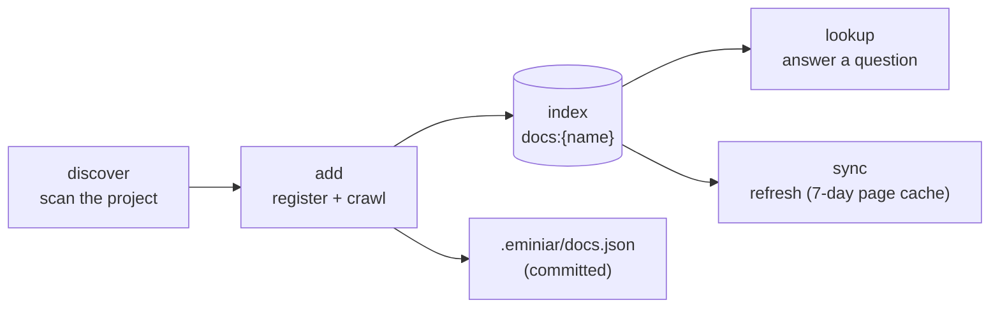

# Documentation knowledge base

[← Docs index](README.md)

Claude knows popular frameworks well. It knows less about your payment provider's API, your
internal OpenAPI spec or last month's SDK release. `em_docs` builds a **local, searchable index
of the documentation your project uses**. Claude checks it before it goes to the web.



## 1. Discover

```text
em_docs {action: "discover"}
```

Discover scans the project and one level of sub-projects (for monorepos and multi-repo
workspaces). **It fetches nothing.**

| Finds | From |
|---|---|
| **Local docs** | READMEs, `docs/` and ADR folders, Copilot / Claude / Cursor instructions in `.github` |
| **API specs** | OpenAPI, Swagger, AsyncAPI, Postman, GraphQL, protobuf |
| **Configuration** | Env examples; Terraform, Kubernetes, Helm, Compose and CI files |
| **Libraries** | npm, PyPI and Go dependencies |
| **Services** | Env var prefixes (for example `STRIPE_*`), container images |
| **Infrastructure** | Terraform, Kubernetes, Istio, Karpenter, Helm, Docker, GitHub Actions |
| **Third-party APIs** | URL literals on request-like lines in your code, grouped by host |

Each finding is matched to documentation:

1. the **built-in catalogue** (about 120 libraries, services and tools);
2. the **npm, PyPI or Go registry** (homepage and README) for packages the catalogue does not
   know;
3. a **probe** of common locations for unknown API hosts (`docs.`, `developer.`, `/docs`,
   `/openapi.json` …).

A spec URL in your code is used directly.

## 2. Add

```text
em_docs {action: "add", pick: "recommended"}
```

`recommended` is deliberately small. It adds your local docs, the **third-party services** you
integrate, and the **APIs found in your code**. Frameworks and platform tools stay out, because
Claude already knows them and their sites are large.

| `pick` | Adds |
|---|---|
| `recommended` | Local docs + services + APIs from code |
| `local` | Local docs only |
| `service` | Catalogue entries with the `service` tier |
| `infra` | Catalogue entries with the `infra` tier |
| `catalog` | All catalogue matches |
| `api` | APIs found in code |
| `registry` | Packages resolved through the registries |
| `all` | Everything discovered |

To add one source:

```text
em_docs {action: "add", url: "https://docs.example.com/api"}
em_docs {action: "add", path: "specs/openapi.yaml"}
em_docs {action: "add", provider: "npm:zod"}
```

### Crawl budgets

| Source | Depth | Max pages |
|---|---|---|
| **External APIs** (hosts in code, linked docs, probed sites, service-tier entries) | 2 | 150 |
| **Dependencies** | 1 | 8 |

Pages are cut at 120 KB and cached for 7 days.

### API specs, one endpoint per section

OpenAPI documents and Postman collections, local or fetched, are rendered as **one markdown
section per operation**. Each section has the parameters, request body, responses and schemas.
A lookup returns the exact endpoint, not a 2 MB spec.

### Lexical by default

Documentation is indexed for keyword search only. A large crawl therefore never queues model
work. Set `docs.embed: true` to also embed it.

## 3. Look up

```text
em_docs {action: "lookup", query: "webhook signature verification"}
```

This searches every documentation source. `em_search {source: "docs:*"}` does the same, and
`docs:<name>` searches one source.

## 4. Keep it fresh

| Action | Effect |
|---|---|
| `sync` | Re-crawls all sources, or the named ones. Pages younger than `docs.ttlHours` (168 hours) come from the cache. `force: true` fetches everything again |
| `list` | Sources, page counts and sync state, plus any sources orphaned in the index |
| `remove` | Drops a source and its pages; works on orphaned sources too |
| `resolve` | Shows where a provider's documentation would come from, for example `provider: "npm:zod"` |

Pages whose source has no manifest entry (the manifest was deleted, or was committed on another
branch) are **orphaned**: `lookup` still serves them and flags them with a note, `sync` never
refreshes them, and `list` shows them in an "Orphaned in the index" section with their page
counts. `remove` with the orphaned name drops those pages; `add` with the same name (or
`pick: "recommended"`) re-registers the source so `sync` picks it up again.

## Hooks keep Claude on the index

- A `WebFetch` of a site that is already a documentation source is annotated with the source
  name.
- A `WebSearch` is told which sources exist. Matching indexed pages are attached.
- The session brief lists the sources.
- `/em-onboard` builds the set and writes the `onboarding/documentation` memory.

## Share and extend

The manifest `.eminiar/docs.json` lists every source. **Commit it**, so teammates get the same
sources and only need to run `sync`.

Add your own catalogue entries with `docs.catalog` in `eminiar.config.json`. Each entry has a
`tier` (`service`, `infra` or `library`).

## Dashboard

The **Docs** tab shows sources, pages and sync state. It also has a discovery screen with
checkboxes and a docs-only search. See [Dashboard](dashboard.md#docs).


