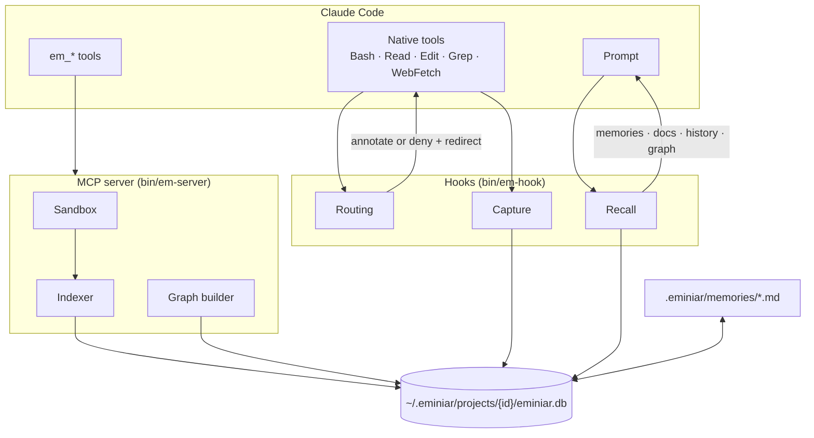

# How it works

[← Docs index](README.md)

eminiar has three parts: **hooks**, an **MCP server** and **local storage**. Claude Code starts
all of them. Nothing runs in the cloud.

## Hooks

The hooks are one small program, `bin/em-hook`. Claude Code runs it on these events:

| Event | What eminiar does |
|---|---|
| `SessionStart` | Adds the project brief: overview, accepted decisions, constraints, hot files, index freshness. After a resume, replays the Session Guide |
| `UserPromptSubmit` | Attaches memories and doc pages that match the prompt |
| `PreToolUse` | Routes noisy calls to `em_*` tools and history or symbol questions to `em_history` / `em_symbols`. Attaches memories and fix history for a file before a read or edit, fan-in before an edit. Lists risky files before `git commit` |
| `PostToolUse` | Captures session events (async, never blocks) |
| `PostToolUseFailure` | Attaches earlier occurrences of the same error and how they were resolved |
| `SubagentStop` | Records the subagent's findings, so `em_recall` can find them later |
| `PreCompact` | Writes a ≤2 KB Session Guide snapshot |
| `Stop` | Classifies Claude's last reply (decisions, summaries) |
| `SessionEnd` | Marks the session as ended and flushes lifetime statistics |

Hooks are fast by design. They never run `git log` and never load the embedding model. Recall
is a few FTS queries against the project database.

## Routing

Routing decides what happens when Claude calls a native tool that an `em_*` tool does better.

| Native call | Suggested tool | Trigger |
|---|---|---|
| `Bash` | `em_history` | `git log`, `git blame`, `git show <sha>`, `git shortlog`, mapped to the matching action (`-- path` → `file`, `A..B` → `branch`, `--grep` → `search`, `-L :fn:file` → `symbol`). A one-commit `git log -1 --format=…` and `git show REF:path` are left alone |
| `Bash` | `em_execute` | A simple command that usually prints a lot (`npm test`, `git diff`, `find`, `grep -r`, `curl` …) or streams an unknown output through `grep`, `sort`, `jq` … |
| `Read` | `em_execute_file` | Files over 200 KB, or data files (`.log`, `.json`, `.csv`, `.xml`, `.sql`, `.har` …) over 20 KB |
| `Grep` | `em_symbols` / `em_search` | The pattern's identifier is a symbol the graph defines. Files-only grep: annotated with the matching symbols. Content-mode grep: denied |
| `Grep` | `em_execute` | Content-mode grep without a `head_limit` for anything else |
| `WebFetch` | `em_fetch_and_index` / `em_docs` | Always. Names the docs source if the site is already indexed |
| `WebSearch` | `em_docs` | When documentation sources exist (annotation only) |
| `Agent`, `Task` | — | Adds eminiar guidance to the subagent prompt and brief |

Set the mode with `routing.mode` in `eminiar.config.json`:

| Mode | Behaviour |
|---|---|
| `auto` (default) | `annotate` while the context-mode plugin is installed, otherwise `enforce` |
| `enforce` | Denies the native call and tells Claude which `em_*` tool to use |
| `annotate` | Allows the call and adds a hint |
| `off` | No routing hints |

**Bash is judged one simple command at a time.** A line is split at `;`, `&&`, `||` and
newlines (heredoc bodies and quoted text are skipped), and each part is classified on its own, so
`cd src && npm test` is heavy because of `npm test`, and the denial names that part. Output that
is bounded by construction stays native:

- a trailing `| head -40`, `| tail -5` or `| wc -l` (up to 400 lines);
- `head` / `tail` of a file, a `sed -n 'A,Bp'` range, `du -s`, `grep -l` / `-c`, `git log -1`;
- `cat` or `grep` over named files small enough for the native `Read` (200 KB in total, 20 KB
  for data files): the same read through Bash;
- a command that changes something (`git commit`, `git checkout`, `npm install`, `rm`, `mv`,
  `sed -i`, a `>` redirection into a file …): its output is secondary, and the native tool is
  where Claude Code's permission prompts live.

Every routing decision is recorded as a `routing` session event: `em_stats` reports how many
native calls were denied or annotated per tool, which `em_*` tool they were sent to and which
rule did it, and `~/.eminiar/hook.log` has one line per denial.

**Safety rule:** `enforce` denies a call only while an eminiar MCP server runs for the project.
The server writes a pid marker under `~/.eminiar/projects/<id>/servers/`. With no server, the
hook annotates instead. Claude is never told to retry with a tool that it cannot reach. For
the same reason, a big `Read` that a `Read` deny or `ask` rule matches is not redirected:
`em_execute_file` would refuse it, so the native `Read` goes ahead under Claude Code's own
permission check.

**Project knowledge is not routing.** Memories, fix history, fan-in and doc notes are attached
in every mode, including `off`. Every such decision is recorded, fired or quiet; `em_stats` and
`eminiar recall --explain` show the hit rate and the reasons (see
[Memory and recall](memory-and-recall.md#rules-that-keep-recall-useful)).

## Sandbox

`em_execute`, `em_batch_execute` and `em_execute_file` run code in a child process in the project
root.

- **Languages:** shell and JavaScript/TypeScript always. Python, Ruby, Go, PHP, Perl, R,
  Elixir, Rust and C# when their tools are installed.
- **Output:** output over `sandbox.indexThreshold` (5 KB) is indexed. Claude gets back only the
  sections that match its `intent`, plus a list of searchable terms.
- **Permissions:** shell snippets are checked against Claude Code's `permissions.deny` and `ask`
  Bash rules, one chained segment at a time. An `ask` rule counts as deny.
- **Files:** the `path` given to `em_execute_file` must be inside the project root, or outside it
  with a `Read(<path>)` allow rule. A matching `Read` deny or `ask` rule refuses the path, inside
  the root or out, even when an allow rule matches. The path as written, its symlink target and
  (on macOS) its on-disk letter case are all checked. This guards the `path` only: the code you
  pass is checked against Bash rules like any snippet, and can still open other files.
- **Read rule forms:** a `Read` pattern is matched as a `*` / `**` glob against the absolute
  path, after a leading `~` becomes your home folder, so `Read(**/.env)` and `Read(~/.ssh/**)`
  match. These do not match yet: Claude Code's relative forms (`./.env`, `.env`, `/path` from the
  settings file, `//path`), `?` and `[...]`, and a `/**/` that should match no folder
  (`~/.aws/**/credentials` does not cover `~/.aws/credentials`).
- **Environment:** the process gets a stripped environment. Credentials for `gh`, `aws`,
  `gcloud`, `kubectl` and `docker` pass through. Add more names with `sandbox.envAllow`.
- **Speed:** these are the hot paths. They are designed to add about 1 ms over a raw process
  spawn. `npm run bench` measures them (see [Development](development.md#benchmarks)).

## Search

Every indexed item is split into chunks. Code is cut at declarations and each chunk is titled
with its symbol name.

- **Lexical:** SQLite FTS5 with porter and trigram tokenizers, BM25 ranking and typo correction.
- **Semantic:** local ONNX embeddings (`Xenova/bge-small-en-v1.5`, 384 dimensions) in
  `sqlite-vec`.
- **Hybrid:** both rankings are fused. If the model is not ready yet, search uses lexical
  results and does not wait.

Each chunk has a `source`, for example `memory`, `git`, `docs:<name>` or a sandbox label. Use
`em_search {source}` to filter.

## Session continuity

The capture hooks sort session events into 27 categories with four priority levels:

| Priority | Categories |
|---|---|
| P1 | files, tasks, plans, rules, user prompt |
| P2 | decisions, git, errors and their resolutions, constraints, blockers, rejected approaches, environment, agent findings, iteration loops, assistant summaries |
| P3 | latency, MCP tools, subagents, skills, external references, role |
| P4 | intent, data, tool calls, session start, recall decisions |

Before `/compact`, eminiar writes a **Session Guide** of 2 KB or less: P1 always, then P2, P3 and
P4 as space allows. When the session resumes, the guide is replayed. `em_search {sort:
"timeline"}` finds the full history.

## Storage

Storage goes through one interface, `src/storage/adapter.ts`. The SQLite adapter
(`better-sqlite3`) is the only module with SQL. A Postgres or libSQL adapter can be added later
for a shared team knowledge base.

## Privacy and data

**All data is local.**

| Location | Contents |
|---|---|
| `~/.eminiar/projects/<id>/eminiar.db` | Index, vectors, graph, history and sessions for one project |
| `~/.eminiar/` (global DB) | Lifetime statistics and the fetch cache |
| `~/.eminiar/models/` | The embedding model |
| `~/.eminiar/plugin/` | The stable plugin copy |
| `<project>/.eminiar/memories/` | Memory files (commit them) |
| `<project>/.eminiar/docs.json` | Documentation sources manifest (commit it) |

eminiar uses the network only to download the embedding model, to fetch pages and documentation
that you ask it to index, and to read package metadata from the npm, PyPI and Go registries. The
dashboard accepts loopback connections only.
