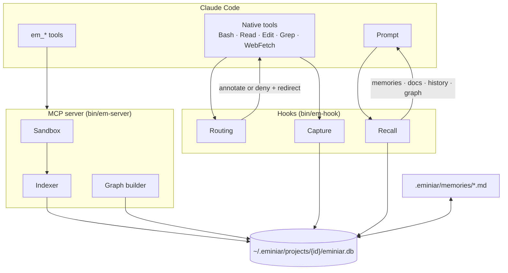

# How it works

[← Docs index](README.md)

eminiar has three parts: **hooks**, an **MCP server** and **local storage**. The client (Claude
Code, or Cursor with `install --cursor`) starts all of them. Nothing runs in the cloud.

## Hooks

The hooks are one small program, `bin/em-hook`. Claude Code runs it on these events (Cursor's
equivalents are [below](#cursor)):

| Event | What eminiar does |
|---|---|
| `SessionStart` | Adds the project brief: overview, accepted decisions, constraints, hot files, index freshness. After a resume, replays the Session Guide |
| `UserPromptSubmit` | Attaches memories and doc pages that match the prompt |
| `PreToolUse` | Routes noisy calls to `em_*` tools and history or symbol questions to `em_history` / `em_symbols`. Attaches memories and fix history for a file before a read or edit, fan-in before an edit. Lists risky files before `git commit` |
| `PostToolUse` | Captures session events (async, never blocks) |
| `PostToolUseFailure` | Attaches earlier occurrences of the same error and how they were resolved |
| `SubagentStart` | Swarm workers only: registers the worker and injects its brief; the worker then claims the `task #N` its prompt names |
| `SubagentStop` | Records the subagent's findings, so `em_recall` can find them later. Closes a swarm worker |
| `PreCompact` | Writes a ≤2 KB Session Guide snapshot |
| `Stop` | Classifies Claude's last reply (decisions, summaries) |
| `SessionEnd` | Marks the session as ended and records its last token usage from the transcript. Lifetime statistics need no flush: each `em_*` call writes them |

Hooks are fast by design. They never run `git log` and never load the embedding model. Recall
is a few FTS queries against the project database.

Every hook uses the project the session started in: `CLAUDE_PROJECT_DIR`, walked up to the
nearest project marker. Claude Code sets it for every hook and for the MCP server, and keeps it
when Claude runs `cd`; Cursor sets it to the workspace root. So after `cd backend && npm test` in
a multi-repo folder, events, decisions, snapshots and usage still go to the database that
`em_search` and `em_recall` read, and a repository's own memories and config apply only to a
session started in it. The payload's `cwd` still resolves relative paths in a Bash command and
decides where a commit hint runs `git`, and swarm tracking tries the `cwd`'s repository after the
session's ([Agent swarms](#agent-swarms)). An edit inside a git worktree of the project
(`.claude/worktrees/…`) is recorded too, but only files a full scan with `graph.include` and
`graph.exclude` would list are re-parsed, so the graph never holds the worktree's copy.
`EMINIAR_PROJECT_ROOT` binds the MCP server and the CLI, not these hooks (see
[Configuration](configuration.md#environment-variables)).

Claude Code discards the output of a hook that outlasts its `timeout` in `hooks/hooks.json`, so
every run also has a time budget below that timeout (3.5 s for the 5 s hooks, 8 s for
`SessionStart`, `PostToolUse` and `SubagentStart`, 12 s for `PreCompact`). Three rules keep a
run inside it:

- **Lock wait.** Many processes share one project database (the main session, every
  swarm worker, the indexer). A hook waits for another process's write lock for a limited time,
  where the CLI and servers wait 2 s, because a handler's waits add up statement by statement.
  Hooks whose answer comes from reads wait 250 ms (`UserPromptSubmit`, every `PreToolUse`
  except the Agent/Task spawn check, and `PostToolUseFailure` of any tool but Agent/Task).
  Hooks whose job is a write wait longer, because losing the write leaves a worker holding its
  slot: 2000 ms for `SessionStart`, `PostToolUse`, `SubagentStart` and `PreCompact`, 1500 ms
  for `SubagentStop`, `SessionEnd`, `Stop`, the `PreToolUse` Agent/Task spawn check and the
  `PostToolUseFailure` of an Agent/Task call, which releases that spawn reservation
  (`busyTimeoutFor` in `src/hooks/budget.ts`). That release runs first; the writes after it
  are best effort and wait 250 ms each, so a lock held past the whole run keeps the hook near
  2 s instead of past its 5 s timeout. Cursor's hooks wait as the Claude Code event
  they translate to: `sessionStart` waits as `SessionStart`, `subagentStop` as `SubagentStop`
  (`lockWaitFor`, called by `src/hook.ts` before the database opens).
- **Best-effort writes.** `UserPromptSubmit`, `SessionStart` and `PostToolUseFailure` still
  answer when the database stays locked past that wait: the session row, the event log and the
  recall statistics are skipped, and the reads (recall, guidance) still run because a reader is
  not blocked by a writer. In `PostToolUseFailure` the first locked write skips the rest, and a
  write is not started with less than 1 s of the budget left. The other write-job hooks are not best effort. If their wait runs
  out they fail open and answer `{}` without the write, except `SubagentStart`: it tries to
  register the worker three times and then answers a short fallback brief, so the worker
  starts unregistered but knows its role and how to claim its task.
- **Deadline.** A run that has not answered by its budget answers `{}` (a denied swarm dispatch
  stays denied when `enforce` is on) and the process exits. The prompt hook skips recall and the
  adjudicator when too little budget is left for them. A `PreToolUse` Agent/Task call denied at
  the deadline (or by a handler error) releases the spawn reservation it made, so the retry the
  deny text invites is not refused for lack of a slot.

### Agent swarms

Swarms are opt-in: without `.eminiar/swarm.yaml` every swarm path below returns after one
`agent_type` prefix test (`swarm-`) or one file-exists check. A swarm problem is logged to
`~/.eminiar/hook.log` and never blocks Claude. Spec: [design/agent-swarms.md](design/agent-swarms.md).

| Event | Swarm work |
|---|---|
| `SessionStart` | With `sync: auto`, regenerates `.claude/agents/swarm-<swarm>-<role>.md` from the YAML. Adds one line naming the swarms and any active run, or a warning naming the first problem in an invalid file |
| `PreToolUse` `Agent` / `Task` | For a `swarm-*` agent: checks `max_agents` and the role's `count`, and reserves the slot. Over capacity, the spawn is denied with the reason. In `enforce` routing mode, routing still adds its prompt prefix, but not the prompt brief: `SubagentStart` briefs the worker instead. In `annotate` mode the prompt is left unchanged |
| `PreToolUse` `em_swarm` | Drops any `caller_*` fields the model passed and stamps the call with the real caller from the hook payload: main session or subagent, `agent_id`, `agent_type` and `session_id`, signed with a per-machine key (`~/.eminiar/swarm.key`). The tool trusts only stamps that verify, so nobody can pose as the coordinator or another worker; an unstamped call can only `list`, `status` and `read`. Never routed or annotated |
| `SubagentStart` | Registers the worker in its run and injects the worker brief: goal, blackboard, memories, history and hot files for its scope. The worker claims the `task #N` its spawn prompt names itself, because parallel spawns of one role cannot be told apart here |
| `PostToolUse` / `PostToolUseFailure` | Counts the worker's tool calls and errors, and adds them to the run's activity feed |
| `SubagentStop` | Marks the worker done and stores its last message. A task it still holds is closed as done (`auto_closed`), or released back to pending when there is no final message |
| `SessionEnd` | Closes the session's workers that never got `SubagentStop` and releases their tasks back to pending |

Settings installs made by an eminiar older than 0.12 lack the `em_swarm` PreToolUse matcher;
`eminiar upgrade` (or `eminiar install`) rewrites the hook entries. The plugin's hooks update
with the plugin.

A role with `isolation: worktree` runs in a git worktree. Its hooks map the worktree back to the
main checkout (the `.git` file's `gitdir:` points into `<main>/.git/worktrees/`), so the swarm
ledger stays in the main project's database.

### Cursor

The same `bin/em-hook` serves Cursor. Cursor speaks a different hook dialect (camelCase events,
flat output, `conversation_id` and `workspace_roots`, `Shell` instead of `Bash`, a JSON string for
the tool result). `src/hooks/cursor.ts` translates both directions, so the handlers above run
unchanged. The client is taken from `--client cursor` in `~/.cursor/hooks.json`, or detected from
the payload when Cursor runs a Claude Code hook through its third-party import.

| Cursor event | Runs as | Note |
|---|---|---|
| `sessionStart` | `SessionStart` | Context goes into `additional_context`; the session id and project root are exported as `env` for the later hooks |
| `beforeSubmitPrompt` | `UserPromptSubmit` | Cursor accepts only `continue` here, so the recalled memories are **parked** and delivered with the next tool result |
| `preToolUse` | `PreToolUse` | Permission only. A deny becomes `permission: "deny"` with the reason as `agent_message`. Memories, fix history and fan-in for the file are parked for the next tool result |
| `postToolUse`, `postToolUseFailure` | `PostToolUse`, `PostToolUseFailure` | Delivers the parked context plus its own in `additional_context` |
| `afterAgentResponse` | `Stop` | Cursor's `stop` carries no text; this one carries the reply that `Stop` classifies |
| `subagentStop`, `preCompact`, `sessionEnd` | same | Observational |

`src/hooks/cursor.ts` also translates `afterFileEdit` (as a `PostToolUse` for `Edit`), but the
installer does not subscribe eminiar to that event, so it never runs.

Parked context is kept per session for ten minutes and delivered once. Two safety rules carry
over: a hook never exits non-zero, and `enforce` routing denies a call only when Cursor has the
eminiar MCP server in `~/.cursor/mcp.json` and a server runs for the project. Otherwise the call
is allowed and the hint is parked.

What Cursor does not have: a status line, `/em-*` slash commands (the skills are available as
agent skills instead), and a session resume. Cursor also applies hooks to its Tab completions
and cloud agents only through its own events, which eminiar does not subscribe to.

## Routing

Routing decides what happens when Claude calls a native tool that an `em_*` tool does better.

| Native call | Suggested tool | Trigger |
|---|---|---|
| `Bash` | `em_history` | `git log`, `git blame`, `git show <sha>`, `git shortlog`, mapped to the matching action (`-- path` → `file`, `A..B` → `branch`, `--grep` → `search`, `-L :fn:file` → `symbol`). A one-commit `git log -1 --format=…` and `git show REF:path` are left alone, and so is a read of another repository (`git -C`, `--git-dir`, a `cd` out of the project or into a nested repository) or in a project that is not a git repository (one with no commits yet reaches `em_history`, which says so) |
| `Bash` | `em_execute` | A simple command that usually prints a lot (`npm test`, `git diff`, `find`, `grep -r`, `curl -s <url>`, `kubectl logs` …) or streams a read-only command's output (`ls`, `cat`, `ps`, `git ls-files`, `gh pr view` …) through filters (`grep`, `sort`, `jq` …) |
| `Read` | `em_execute_file` | Files over 200 KB, or data files (`.log`, `.json`, `.csv`, `.xml`, `.sql`, `.har` …) over 20 KB, read whole (no `offset` / `limit`) from inside the project |
| `Grep` | `em_symbols` / `em_search` | The pattern's identifier is a symbol the graph defines. Files-only grep: annotated with the matching symbols. Content-mode grep: denied |
| `Grep` | `em_execute` | Content-mode grep without a `head_limit` for anything else |
| `WebFetch` | `em_fetch_and_index` / `em_docs` | Always. Names the docs source if the site is already indexed |
| `WebSearch` | `em_docs` | When documentation sources exist (annotation only) |
| `Agent`, `Task` | — | `enforce`: adds eminiar guidance and the project brief (with memories and doc pages for the task) to the subagent prompt; swarm workers get the guidance only, their brief comes from `SubagentStart`. `annotate`: the prompt is unchanged, and the brief goes to the main session as context, not to the subagent. `off`: nothing |

A `Grep` with a `head_limit` is never denied: for a symbol the graph defines it is annotated like
a files-only grep, and otherwise it is left alone.

Set the mode with `routing.mode` in `eminiar.config.json`:

| Mode | Behaviour |
|---|---|
| `auto` (default) | `annotate` while the context-mode plugin is installed, otherwise `enforce`. With `routing.deferToContextMode` on, `Bash`, `Read`, `Grep` and `WebFetch` get no routing hint while it is installed (see below) |
| `enforce` | Denies the native call and tells Claude which `em_*` tool to use |
| `annotate` | Allows the call and adds a hint |
| `off` | No routing hints |

While the context-mode plugin is installed and `routing.deferToContextMode` is `true` (the default),
every mode except `off` stops suggesting `em_*` tools for `Bash`, `Read`, `Grep` and `WebFetch`,
because context-mode already routes them. eminiar still adds the hints only it has: symbol matches,
coverage warnings and file memos.

**Bash is judged one simple command at a time.** A line is split at `;`, `&&`, `||` and
newlines (heredoc bodies and quoted text are skipped), and each part is classified on its own, so
`cd src && npm test` is heavy because of `npm test`, and the denial names that part. One
exception: if any part changes something (last item below), the whole line stays native, so
`npm test && git commit` is not routed. Output that is bounded by construction stays native:

- a trailing `| head -40`, `| tail -5` or `| wc -l` (up to 400 lines);
- `head` / `tail` of a file, a `sed -n 'A,Bp'` range, `du -s`, `grep -l` / `-c`, `git log -1`;
- `cat` or `grep` over named files small enough for the native `Read` (200 KB in total, 20 KB
  for data files): the same read through Bash;
- a command it recognises as changing something (`git commit`, `npm install`, `rm`, `sed -i`,
  a `>` redirection into a file, `kubectl delete`, `curl -X POST`, `gh api -f …`,
  `terraform apply`, `npm run deploy`, `find … -delete`, `… | xargs rm`, `… | sh` …), in any
  stage of a pipe or inside `$(…)`, after `sudo`, `env`, `time`, `timeout`, `{`, `!`, `then`,
  `do` and similar: its output is secondary, and the native tool is where Claude Code's
  permission prompts live. Tools with read-only forms are routed only in those: `kubectl get` /
  `logs`, `docker ps` / `logs`, `curl` with no method other than `GET` / `HEAD`, body, upload or
  output file, `wget -O -`, and test, lint or check scripts or `make` targets not asked to fix
  or update;
- a follow or a watch (`tail -f`, `kubectl logs -f`, `kubectl get -w`, `docker logs -f`,
  `--watch`): it never finishes, so `em_execute` would only time out on it;
- a pipe into anything but a known filter (`git diff | patch -p1`, `cat dump.sql | psql`,
  `ls | xargs ./x.sh | sort`), or from a command it does not know (`ssh host … | grep`): either
  may change something, so only known filters after the first stage, and a known read-only
  source for a pipe that is routed for its filter, are sent to `em_execute`.

Routing decisions are recorded as `routing` session events, except in `off` mode and for the
calls left to context-mode. `em_stats` reports totals, not single decisions: how many native
calls were denied or annotated per tool, which `em_*` tool they were sent to and which rule did
it. `~/.eminiar/hook.log` has one line per denial.

**Safety rule:** `enforce` denies a call only while an eminiar MCP server runs for the project.
The server writes a pid marker under `~/.eminiar/projects/<id>/servers/`. With no server, the
hook annotates instead. Claude is never told to retry with a tool that it cannot reach. For
the same reason, a big `Read` that `em_execute_file` would refuse is not redirected (a file
outside the project, Claude Code's own saved tool outputs among them, or one a `Read` deny or
`ask` rule matches): the native `Read` goes ahead under Claude Code's own permission check. A
`git log` that `em_history` cannot answer is judged like any other command.

**Project knowledge is not routing.** Memories, fix history, fan-in and doc notes for files,
commits and web calls are attached in every mode, including `off`. The subagent brief is the
exception: it follows the routing mode (see `Agent`, `Task` above). Every recall decision is
recorded, fired or quiet; `em_stats` and
`eminiar recall --explain` show the hit rate and the reasons (see
[Memory and recall](memory-and-recall.md#rules-that-keep-recall-useful)).

## Sandbox

`em_execute`, `em_batch_execute` and `em_execute_file` run code in a child process in the project
root.

- **Languages:** shell and JavaScript/TypeScript always. Python, Ruby, Go, PHP, Perl, R,
  Elixir and Rust when their tools are installed, and C# when `dotnet-script` is installed.
  JavaScript and TypeScript snippets run
  as ES modules; a snippet that calls `require(...)` gets one that resolves packages and
  relative paths from the project root, as a script of the project would.
- **Output:** output over `sandbox.indexThreshold` (5 KB) is indexed. Claude gets back only the
  sections that match its `intent`, plus a list of searchable terms. Secrets are masked in the
  stored copy (see [Privacy and data](#privacy-and-data)). Output shown inline, and the head and
  tail preview, are as printed; sections found for an `intent` or `queries` come from the masked
  copy.
- **Permissions:** shell snippets are checked against Claude Code's `permissions.deny` and `ask`
  Bash rules, one chained segment at a time. An `ask` rule counts as deny.
- **Files:** the `path` given to `em_execute_file` must be inside the project root, or outside it
  with a `Read(<path>)` allow rule. A matching `Read` deny or `ask` rule refuses the path, inside
  the root or out, even when an allow rule matches. The path as written, its symlink target and
  (on macOS) its on-disk letter case are all checked. This guards the `path` only: the code you
  pass is checked against Bash rules like any snippet, and can still open other files. `em_index`
  applies the same check to its `path`, and skips (and lists) the files under a directory that
  a rule matches.
- **Read rule forms:** `Read` patterns resolve as Claude Code resolves them: `//path` is an
  absolute path, `~/path` is under your home folder, `./path`, `path/with/slash` and `/path` are
  under the project root (`/path` also matches the absolute `/path`, as earlier versions read
  it), and a name without a slash (`.env`, `*.pem`) matches at any depth under the project root.
  A pattern that starts with `**` matches anywhere. `*` stays within one folder, `**` crosses
  folders, `/**/` also matches no folder (`~/.aws/**/credentials` covers `~/.aws/credentials`),
  `?` is one character, and a matched folder covers the files below it. `[...]` is not supported.
  A file a rule denies is skipped by the indexers and also removed from the index when an earlier
  run had indexed it; files that no longer exist leave the index on the next sync too.
- **Environment:** the process gets a stripped environment. Credentials for `gh`, `aws`,
  `gcloud`, `kubectl` and `docker` pass through. Add more names with `sandbox.envAllow`.
- **Speed:** these are the hot paths. They are designed to add about 1 ms over a raw process
  spawn. `npm run bench` measures them (see [Development](development.md#benchmarks)).

### What the sandbox enforces

The sandbox keeps output out of context. It is not an isolation boundary. Beyond the
permission and file checks above:

- Code in languages other than shell is not checked against any rule. `sandbox.disabledLanguages`
  turns languages off.
- Your own `PreToolUse` hooks on `Bash` do not see these calls, and Claude Code asks for
  permission, if at all, for the tool call as a whole, not for each command in it.
- There is no filesystem or network isolation: code runs as you, in the project root.

To check these calls yourself, add a `PreToolUse` hook with the matcher
`mcp__.*__em_(execute|batch_execute|execute_file)` (plugin installs name the tools
`mcp__plugin_eminiar_eminiar__em_*`, settings installs `mcp__eminiar__em_*`). It receives the
code in `tool_input.code` (`em_execute`, `em_execute_file`), each command in
`tool_input.commands[].command` (`em_batch_execute`), and the file in `tool_input.path`
(`em_execute_file`).

## Search

Every indexed item is split into chunks. Code is cut at declarations and each chunk is titled
with its symbol name.

- **Lexical:** SQLite FTS5 with porter and trigram tokenizers, BM25 ranking and typo correction.
- **Semantic:** local ONNX embeddings (`Xenova/bge-small-en-v1.5`, 384 dimensions) in
  `sqlite-vec`.
- **Hybrid:** both rankings are fused. If the model is not ready yet, search uses lexical
  results and does not wait.

Each chunk has a `source`, for example `memory`, `git`, `docs:<name>` or a sandbox label. Use
`em_search {source}` to filter.

## Session continuity

The capture hooks sort session events into 28 categories with four priority levels:

| Priority | Categories |
|---|---|
| P1 | files, tasks, plans, rules, user prompt |
| P2 | decisions, git, errors and their resolutions, constraints, blockers, rejected approaches, environment, agent findings, iteration loops, assistant summaries |
| P3 | latency, MCP tools, subagents, skills, external references, role |
| P4 | intent, data, tool calls, session start, recall decisions, routing decisions |

Before `/compact`, eminiar writes a **Session Guide** of 2 KB or less: P1 always, then P2, P3 and
P4 as space allows. Recall and routing decisions are never put in the guide. When the session
resumes, the guide is replayed. `em_search {sort: "timeline"}` finds the full history.

## Storage

Project storage goes through one interface, `src/storage/adapter.ts`, and the SQLite adapter
(`better-sqlite3`, `src/storage/sqlite/`) holds the project database's SQL. A Postgres or libSQL
adapter can be added later for a shared team knowledge base. The global database
(`~/.eminiar/global.db`: lifetime statistics and the fetch cache) is not behind that interface:
`src/stats/global.ts` opens it and runs its own SQL.

## Privacy and data

**All data is local.**

| Location | Contents |
|---|---|
| `~/.eminiar/projects/<id>/eminiar.db` | Index, vectors, graph, history and sessions for one project |
| `~/.eminiar/global.db` | Lifetime statistics and the fetch cache |
| `~/.eminiar/config.json` | Your personal configuration, including adjudicator consent |
| `~/.eminiar/hook.log` | Hook diagnostics, including the first 120 characters of each command, path or URL that routing denied |
| `~/.eminiar/swarm.key` | The per-machine key that signs `em_swarm` caller stamps |
| `~/.eminiar/adjudicator.key` | Adjudicator provider keys, written by `eminiar adjudicator key set`, and by the hidden key prompt that the adjudicator step of `eminiar install` and `eminiar adjudicator enable` show in a terminal when the chosen provider needs a key and none is stored |
| `~/.eminiar/tmp/` | Scratch files for sandbox snippets, deleted after each run |
| `~/.eminiar/install.json`, `node-path`, `root-path` | The install record and the pinned Node.js and plugin paths |
| `~/.eminiar/models/` | The embedding model |
| `~/.eminiar/plugin/` | The stable plugin copy |
| `<project>/.eminiar/memories/` | Memory files (commit them) |
| `<project>/.eminiar/docs.json` | Documentation sources manifest (commit it) |
| `<project>/.eminiar/playbooks/` | Playbook files (commit them) |
| `<project>/.eminiar/playbooks-private/` | Private playbooks (git-ignored) |

On macOS and Linux, `~/.eminiar` is readable by you alone (mode 0700), and each database with its
`-wal` and `-shm` files is 0600. An existing `~/.eminiar` is tightened the next time eminiar opens
it; a folder that `EMINIAR_HOME` points at is tightened only when it holds nothing but eminiar's
own files, so a project or shared folder keeps its mode. Files in your project (memories,
`eminiar.config.json`) keep the modes git gives them.

Command and page output (`em_execute`, `em_batch_execute`, `em_execute_file`,
`em_fetch_and_index`) is stored with its secrets masked, and so is the short error text of a
failed tool call that session history keeps. Masked are tokens and keys with a known shape
(`sk-…`, `ghp_…`, `ya29.…`, `hvs.…`, AWS, Slack, Stripe, JWTs, private key blocks), `Authorization`
and cookie values, credentials in URLs, password flags on command lines, and `name=value` pairs
whose name is a secret's (`AWS_SECRET_ACCESS_KEY`, `db_password`, `apiKey`). So `env` is stored as
`GH_TOKEN=***`. Git SHAs, checksums, emails and base64 are kept, as is a lone `key` whose value
reads as a name or a path (S3's `"Key": "photos/a.jpg"`, `key: string`), so the output stays
searchable. The masking is best effort: a secret with no known shape and no secret name (an
opaque token printed on its own line, a password in prose) is stored as printed.

Stored as written: your prompts, Claude's replies, subagent reports and the command line that
session events record for each tool call (session history indexes some of these for `em_recall`),
pages indexed by `em_docs`, and the fetch cache in the global database. Command and page
output stored by an older version is masked in place, each document as one text, by the server in
the background after it starts (in short slices, resuming where it stopped); each later start goes
over what was stored since, which catches output from an older eminiar still running. Error text that session history kept before
then stays as it was until `em_purge {scope: "sessions"}`. Text that a mask or a delete replaces
can stay in free database pages until SQLite reuses them; `eminiar purge <scope> --yes` runs a
VACUUM.

`em_purge {scope: "sessions"}` deletes the captured events with the session history `em_recall`
searches, and the playbook runs and suggestions; command output belongs to the `index` scope.

eminiar uses the network only to download the embedding model, to fetch pages and documentation
that you ask it to index, to read package metadata from the npm, PyPI and Go registries, to
download the eminiar package and its dependencies from the npm registry (`install`, and
`eminiar@latest` on `upgrade`), and, only when you turn on the adjudicator with a remote provider
and consent, to send redacted prompt and task text to that provider. The dashboard accepts
loopback connections only.
